<p align="center">
  <picture>
    <source media="(prefers-color-scheme: dark)" srcset="./.github/text-logo.svg">
    
  </picture>
</p>

<h3 align="center">Ícones de tecnologias em um único SVG, para README, portfólio e currículo</h3>

<p align="center">
  Fork de <a href="https://github.com/tandpfun/skill-icons">tandpfun/skill-icons</a> mantido por <a href="https://gcruz.dev.br">gcruz.dev</a> ·
  <strong>270 ícones</strong> · 19 categorias · temas claro e escuro · 85 animações
</p>

<div align="center">

[](https://icons.gcruz.dev.br)
[](https://github.com/https-shini/skill-icons/actions/workflows/wrangler-action.yml)
[](LICENSE)

</div>

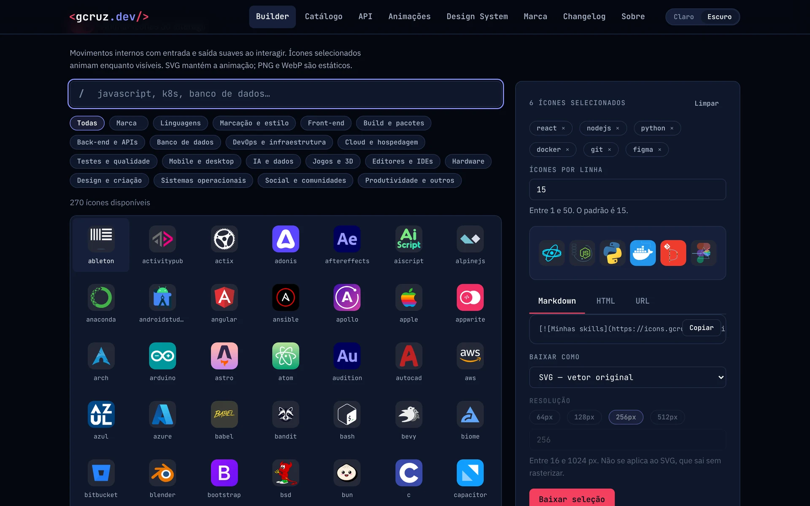

<p align="center">
  <a href="https://icons.gcruz.dev.br"><strong>Acessar o site</strong></a> ·
  <a href="#referência-da-api">Referência da API</a> ·
  <a href="#lista-de-ícones">Lista de ícones</a> ·
  <a href="DEPLOY.md">Publicar a sua instância</a>
</p>

---

## Sumário

- [Sobre o projeto](#sobre-o-projeto)
- [Problema e proposta](#problema-e-proposta)
- [Funcionalidades](#funcionalidades)
- [Capturas de tela](#capturas-de-tela)
- [Tecnologias](#tecnologias)
- [Como usar](#como-usar)
- [Referência da API](#referência-da-api)
- [Ícones da marca `<gcruz.dev/>`](#ícones-da-marca-gcruzdev)
- [Arquitetura](#arquitetura)
- [Pré-requisitos](#pré-requisitos)
- [Instalação e execução local](#instalação-e-execução-local)
- [Testes e validações](#testes-e-validações)
- [Build e deploy](#build-e-deploy)
- [Lista de ícones](#lista-de-ícones)
- [Adicionar um ícone](#adicionar-um-ícone)
- [Documentação complementar](#documentação-complementar)
- [Créditos e licença](#créditos-e-licença)

## Sobre o projeto

O Skill Icons gera, a partir de uma única URL, um SVG com vários ícones de tecnologias lado a lado — pronto para ser colado em um README do GitHub, num portfólio ou num currículo. Uma requisição devolve o badge completo; não é preciso versionar imagens nem montar nada à mão.

Este fork amplia o projeto original com 270 IDs (459 arquivos SVG, 189 deles com par claro/escuro), 81 aliases, 19 categorias, uma biblioteca de 85 animações vetoriais e um site estático para buscar, montar, copiar e baixar os ícones. Os ícones adicionados aqui — como `oracle`, `sql`, `jwt`, `render` e os da marca `gcruz` — não existem no domínio oficial `skillicons.dev`.

## Problema e proposta

Exibir a stack de um desenvolvedor costuma exigir dezenas de imagens soltas, cada uma com tamanho, fundo e estilo diferentes. O Skill Icons padroniza todos os ícones (mesmo _viewBox_, raio e área útil) e os compõe no servidor em um único SVG, com tema e quantidade por linha configuráveis pela própria URL.

## Funcionalidades

- **Composição por URL** — `/icons?i=ts,react,nodejs` devolve um único SVG com os ícones na ordem pedida.
- **Temas claro e escuro** — `theme=light|dark` para os 189 ícones com par; os demais usam a cor da própria marca.
- **Layout configurável** — `perline` de 1 a 50 ícones por linha (padrão 15).
- **Animações vetoriais opcionais** — `animation=true` aplica uma de 85 animações em 8 universos; `model=` escolhe o modelo. Sem o parâmetro, a saída é estática.
- **Site com montador** — busca por nome, alias ou categoria, preview ao vivo e snippets em Markdown, HTML e URL.
- **Download no navegador** — SVG, PNG ou WebP, um arquivo ou um `.zip` com a seleção, sem endpoint extra.
- Catálogo por categoria, galeria de animações, página da marca, design system e changelog.
- 81 aliases de nome curto (`js`, `ts`, `py`, `k8s`…) e erros `400` que identificam o parâmetro inválido.
- Duas plataformas de publicação a partir do mesmo código: Vercel e Cloudflare Workers.

## Capturas de tela

|                            Página inicial                            |                                    Saída real da API                                     |
| :------------------------------------------------------------------: | :--------------------------------------------------------------------------------------: |
| 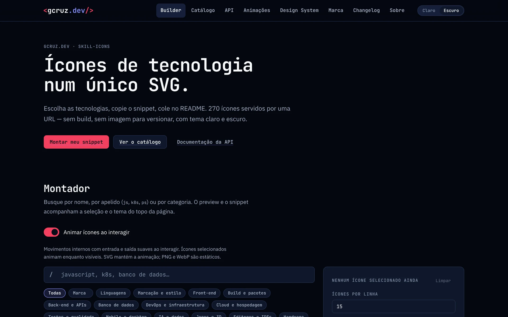 | 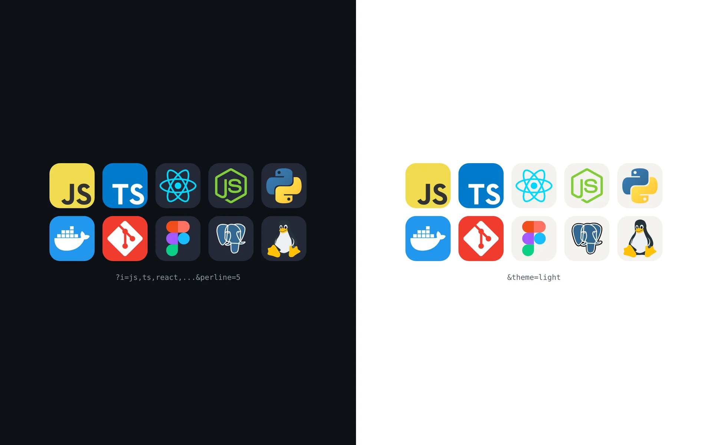 |
|                             **Catálogo**                             |                                 **Galeria de animações**                                 |
|  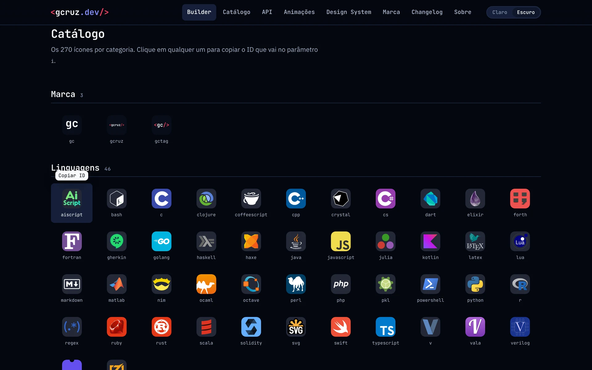   |        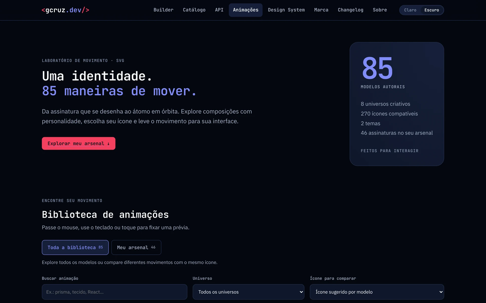         |
|                              **Marca**                               |                                    **Design system**                                     |
|  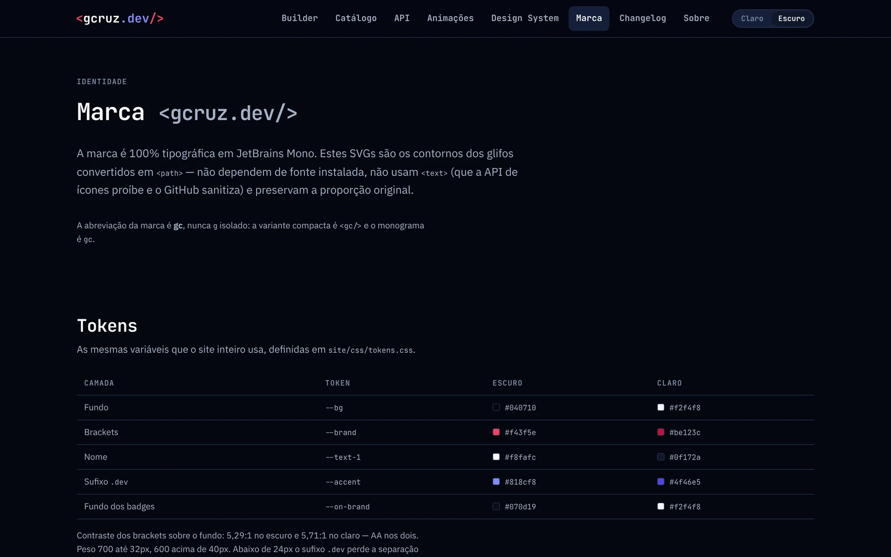  |    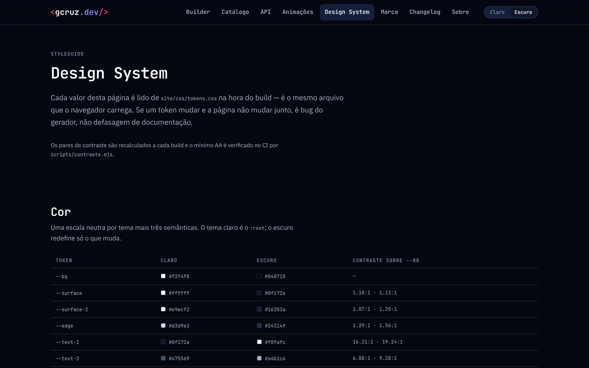     |
|                            **Tema claro**                            |                                       **Celular**                                        |
|   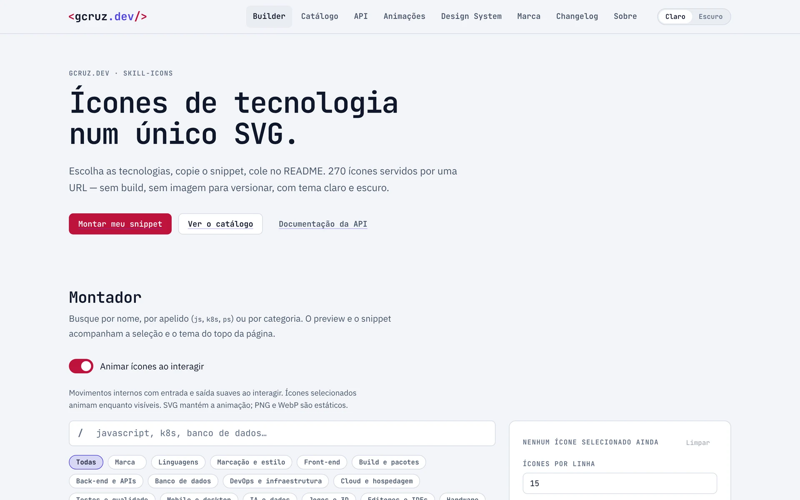    |  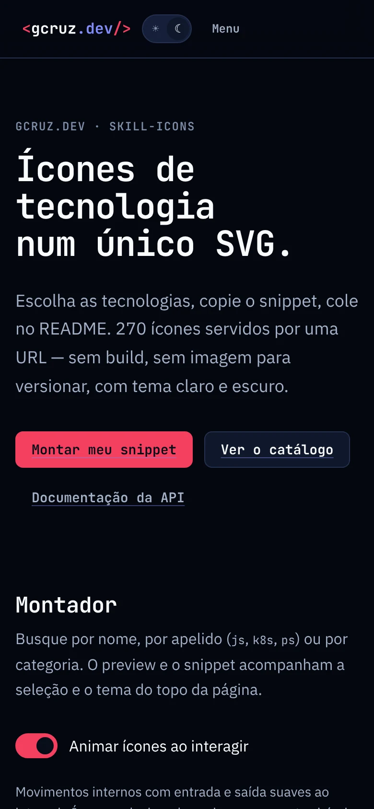  |

> Capturas do site publicado em [icons.gcruz.dev.br](https://icons.gcruz.dev.br).

## Tecnologias

- **JavaScript (ESM)** — lógica de resolução de nomes, composição do SVG e animações (`lib/`).
- **SVG** — ícones normalizados em `256 × 256` e saída composta.
- **Vercel Functions** — entradas da API em `api/*.mjs` e site estático em `public/`.
- **Cloudflare Workers** — entrada alternativa em `index.js`, publicada com **Wrangler**.
- **HTML/CSS** — site estático sem framework, composto em build a partir de `site/`.
- **node:test** — testes do catálogo, do montador e das animações.
- **Playwright** — verificações do site, de responsividade e visuais das animações.
- **Prettier** — formatação.
- **GitHub Actions** — validação do catálogo, contraste, normalização, testes, build e deploy no Workers.

## Como usar

Liste os IDs separados por vírgula no parâmetro `i` (ou `icons`):

```md
[](https://gcruz.dev.br)
```

<p>
  
  
  
  
</p>

**Tema** — `theme` (ou `t`) define o fundo do badge; o padrão é `dark`:

```md
[](https://gcruz.dev.br)
```

<p>
  
  
  
  
</p>

**Ícones por linha** — `perline` aceita de 1 a 50:

```md
[](https://gcruz.dev.br)
```

**Centralizar** — o SVG se redimensiona sozinho; qualquer técnica de centralização de imagem funciona:

```html
<p align="center">
  <a href="https://gcruz.dev.br">
    
  </a>
</p>
```

**Animações** — opcionais e restritas ao SVG (PNG e WebP são estáticos):

```text
https://icons.gcruz.dev.br/icons?i=react,ts,python&animation=true
https://icons.gcruz.dev.br/icons?i=gemini&animation=true&model=explosao-reconstroi
```

O movimento pausa fora da área visível e respeita `prefers-reduced-motion`. A galeria em [icons.gcruz.dev.br/animacoes](https://icons.gcruz.dev.br/animacoes) permite comparar modelos com qualquer ícone.

> [!IMPORTANT]
> `icons.gcruz.dev.br` é a instância **deste fork**. Para usar na sua própria infraestrutura, publique uma instância seguindo o [DEPLOY.md](DEPLOY.md) e troque o domínio nos exemplos.

## Referência da API

| Rota                   | Devolve                                                    |
| :--------------------- | :--------------------------------------------------------- |
| `/icons?i=js,html`     | O SVG composto. Aceita `i` ou `icons`                      |
| `/icons?i=all`         | Todos os ícones                                            |
| `&theme=light`         | Fundo claro nos ícones com par. Padrão `dark`. Aceita `t`  |
| `&perline=9`           | Ícones por linha, de 1 a 50. Padrão 15                     |
| `&animation=true`      | Versão animada; `&model=<id>` escolhe o modelo             |
| `/api/icons`           | JSON com a lista de IDs                                    |
| `/api/manifest`        | JSON com ID, existência de tema e arquivo de cada variante |
| `/api/svgs`            | JSON com todos os SVGs crus                                |
| `/api/animations`      | JSON com os modelos de animação e seus conceitos           |
| `/svg/<Arquivo>.svg`   | O SVG individual, estático e em cache na CDN               |
| `/brand/<arquivo>.svg` | Os assets da marca                                         |

| Requisição inválida | Resposta                          |
| :------------------ | :-------------------------------- |
| `?i=js,naoexiste`   | `400 Unknown icon: naoexiste`     |
| `?perline=0`        | `400` — fora do intervalo 1–50    |
| `?theme=azul`       | `400` — apenas `dark` ou `light`  |
| `/icons` sem `i`    | `400` — nenhum ícone especificado |

Os aliases ficam em `ICON_ALIASES`, em [`lib/catalog.mjs`](lib/catalog.mjs).

## Ícones da marca `<gcruz.dev/>`

A marca é tipográfica, em JetBrains Mono convertida em `<path>`, e três IDs estão disponíveis na API como qualquer outro ícone:

| ID      | Exibe          | Legível a partir de | Uso                                     |
| :------ | :------------- | :------------------ | :-------------------------------------- |
| `gcruz` | `<gcruz/>`     | 48 px               | Badge principal, com o nome por extenso |
| `gctag` | `<gc/>`        | 24 px               | Assinatura curta                        |
| `gc`    | monograma `gc` | 16 px               | Espaços mínimos                         |

```md
[](https://gcruz.dev.br)
```

Todos os assets, tokens, pesos e regras de uso estão em [`brand/`](brand/) e na especificação [`brand/README.md`](brand/README.md); a página [/marca](https://icons.gcruz.dev.br/marca) mostra as variações nos dois temas.

## Arquitetura

A mesma biblioteca (`lib/`) atende às duas plataformas. O build empacota os SVGs de `icons/` em `dist/`, e cada entrada (função da Vercel ou Worker) resolve nomes e aliases, valida os parâmetros e concatena os ícones em um SVG com grade calculada por `perline`.

```text
icons/*.svg ──► build.js ──► dist/icons.{json,mjs}
                                 │
              ┌──────────────────┴──────────────────┐
              ▼                                     ▼
       api/*.mjs (Vercel)                   index.js (Cloudflare Worker)
              └──────────────► lib/icons.mjs ◄──────┘
                         resolução, validação e composição
                         lib/animation.mjs + motion-*.mjs (animações)

site/ (pages, partials, css, js) ──► scripts/build-pages.mjs ──► public/
```

<details>
<summary><strong>Estrutura de diretórios</strong></summary>

```text
icons/                     os 270 ícones (459 arquivos, contando os pares de tema)
brand/                     assets e especificação da marca <gcruz.dev/>
lib/                       resolução, composição, catálogo e animações
api/*.mjs                  entradas da Vercel
index.js                   entrada do Cloudflare Worker
site/
  css/tokens.css           fonte única de cor, tipografia, espaço e movimento
  js/                      tema, busca, montador, download, zip e galeria
  partials/ · pages/       cabeçalho, rodapé e uma página por arquivo
  fonts/                   JetBrains Mono e IBM Plex Sans (auto-hospedadas)
scripts/                   build do site, tabela do README, contraste, normalização,
                           responsividade e verificações com Playwright
tests/                     testes do catálogo, dos assets e das animações
docs/                      planos, inventário, biblioteca de animações e capturas
public/                    saída do build (não editar à mão)
```

</details>

## Pré-requisitos

- **Node.js 24** (definido em `engines` e usado na CI) e **Yarn** ou **npm**.
- Para as verificações de navegador: Playwright com Chromium.
- Para publicar no Workers: conta na Cloudflare e **Wrangler** (instalado como dependência de desenvolvimento).

## Instalação e execução local

```bash
git clone https://github.com/https-shini/skill-icons.git
```

```bash
cd skill-icons
```

```bash
npm install
```

```bash
npm run dev:web
```

O comando gera o build e sobe o site em http://localhost:4173, reproduzindo o roteamento da Vercel. Para testar a versão Cloudflare Workers, use `npm run dev`.

O projeto não exige variáveis de ambiente para rodar nem para publicar na Vercel. O deploy automático no Workers usa os secrets `CF_API_TOKEN` e `CF_ACCOUNT_ID` do GitHub Actions, descritos no [DEPLOY.md](DEPLOY.md).

## Testes e validações

| Comando                      | O que faz                                                                                     |
| ---------------------------- | --------------------------------------------------------------------------------------------- |
| `npm test`                   | Build + testes do catálogo, dos assets e das animações (`node:test`)                          |
| `npm run readme:check`       | Confere se a lista de ícones deste README está em dia com `icons/`                            |
| `npm run contraste:check`    | Verifica o contraste dos tokens do site                                                       |
| `npm run icones:check`       | Verifica a normalização dos SVGs                                                              |
| `npm run test:web`           | Verifica o site no navegador (com o site local ativo)                                         |
| `npm run responsivo`         | Percorre as páginas em 15 larguras e 2 temas: sem rolagem horizontal e alvos de toque ≥ 44 px |
| `npm run test:motion:visual` | Verificação visual das animações                                                              |

Na última verificação, `npm test` executou **18 testes, todos aprovados**, e a lista de ícones estava em dia com os 270 IDs.

## Build e deploy

| Plataforma              | Comando             | Observações                                                                 |
| ----------------------- | ------------------- | --------------------------------------------------------------------------- |
| Vercel (produção atual) | `npm run build:web` | Saída em `public/`; `/icons` é reescrito para `/api/render` (`vercel.json`) |
| Cloudflare Workers      | `npm run deploy`    | Usa `wrangler.toml`; também é publicado pela CI ao fazer push na `main`     |

O passo a passo, com domínio próprio e limites de tamanho, está em [DEPLOY.md](DEPLOY.md).

## Lista de ícones

Tabela gerada a partir de [`icons/`](./icons) por
[`scripts/readme-table.mjs`](./scripts/readme-table.mjs). Para regenerar:
`npm run readme`. O CI roda `npm run readme:check` e falha se ela estiver
defasada.

### Marca `<gcruz.dev/>`

Os ícones da marca. Detalhes e assets em [Ícones da marca](#ícones-da-marca-gcruzdev).

| Icon ID |                     Icon                      |
| :-----: | :-------------------------------------------: |
|  `gc`   |     |
| `gcruz` | 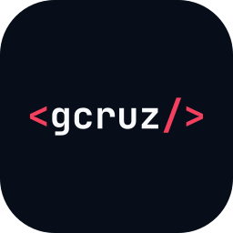 |
| `gctag` | 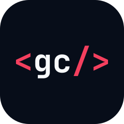 |

### Linguagens

|    Icon ID     |                         Icon                         |
| :------------: | :--------------------------------------------------: |
|   `aiscript`   |      |
|     `bash`     |          |
|      `c`       |                  |
|   `clojure`    |       |
| `coffeescript` |  |
|     `cpp`      |                |
|   `crystal`    |       |
|      `cs`      |                 |
|     `dart`     |          |
|    `elixir`    |        |
|    `forth`     |              |
|   `fortran`    |            |
|   `gherkin`    |       |
|      `go`      |             |
|   `haskell`    |       |
|     `haxe`     |          |
|     `java`     |          |
|      `js`      |         |
|    `julia`     |         |
|    `kotlin`    |        |
|    `latex`     |         |
|     `lua`      |           |
|    `matlab`    |        |
|      `md`      |      |
|     `nim`      |           |
|    `ocaml`     |              |
|    `octave`    |        |
|     `perl`     |               |
|     `php`      |           |
|     `pkl`      |     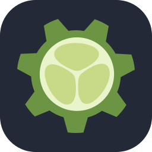      |
|  `powershell`  |    |
|      `py`      |        |
|      `r`       |             |
|    `regex`     |         |
|     `ruby`     |               |
|     `rust`     |               |
|    `scala`     |         |
|   `solidity`   |           |
|     `svg`      |           |
|    `swift`     |              |
|      `ts`      |         |
|      `v`       |             |
|     `vala`     |               |
|   `verilog`    |            |
|     `wasm`     |        |
|     `zig`      |           |

### Marcação e estilo

|      Icon ID       |                        Icon                         |
| :----------------: | :-------------------------------------------------: |
|    `bootstrap`     |         |
|       `css`        |               |
|     `emotion`      |      |
|       `html`       |              |
|       `less`       |         |
|    `materialui`    |   |
|       `pug`        |          |
|       `sass`       |              |
| `styledcomponents` |  |
|     `tailwind`     |  |
|     `vuetify`      |   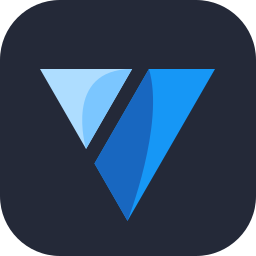   |
|     `windicss`     |     |

### Front-end

|    Icon ID    |                        Icon                         |
| :-----------: | :-------------------------------------------------: |
|  `alpinejs`   |     |
|   `angular`   |      |
|    `astro`    |             |
|     `d3`      |           |
|    `ember`    |             |
|   `gatsby`    |            |
|    `htmx`     |    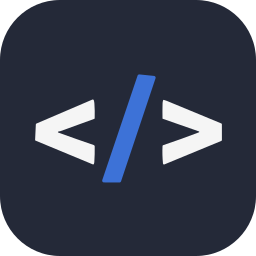     |
|   `jquery`    |            |
|     `lit`     |          |
|   `lucide`    |       |
|   `motion`    |       |
|   `nextjs`    |       |
|   `nuxtjs`    |       |
|    `p5js`     |              |
|    `pinia`    |        |
| `processing`  |   |
|    `react`    |        |
|  `reactivex`  |    |
| `reactrouter` | 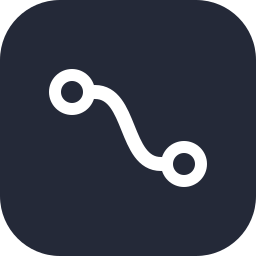 |
|    `redux`    |             |
|    `remix`    |        |
|   `solidjs`   |      |
|   `svelte`    |            |
|   `threejs`   |      |
|     `vue`     |        |
|     `yew`     |     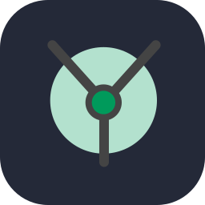     |

### Build e pacotes

|  Icon ID   |                       Icon                       |
| :--------: | :----------------------------------------------: |
|  `babel`   |          |
|  `cmake`   |     |
|  `gradle`  |    |
|   `gulp`   |           |
|  `maven`   |     |
|   `npm`    |   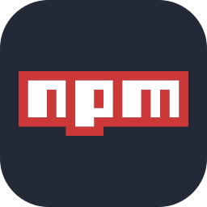    |
|   `pnpm`   |   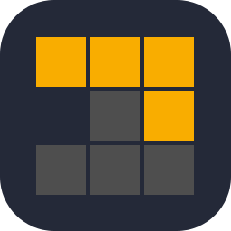   |
| `rollupjs` |  |
|   `vite`   |      |
| `webpack`  |   |
|   `yarn`   |   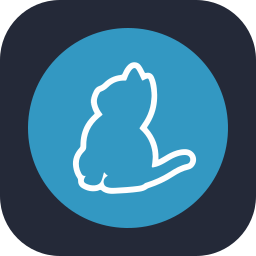   |

### Back-end e APIs

|   Icon ID   |                       Icon                        |
| :---------: | :-----------------------------------------------: |
|   `actix`   |      |
|  `adonis`   |          |
|  `apollo`   |          |
| `appwrite`  |        |
|    `bun`    |        |
|   `deno`    |       |
|  `django`   |          |
|  `dotnet`   |          |
|  `elysia`   |  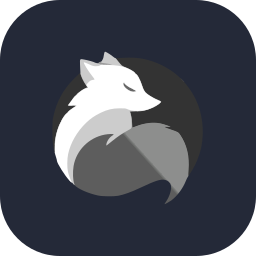   |
|  `express`  |  |
|  `fastapi`  |         |
| `firebase`  |   |
|   `flask`   |      |
|  `graphql`  |    |
|   `jinja`   |   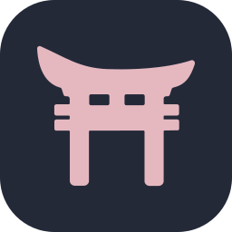   |
|    `jwt`    |        |
|   `kafka`   |           |
|   `ktor`    |       |
|  `laravel`  |    |
|  `nestjs`   |     |
|   `nginx`   |           |
|  `nodejs`   |     |
| `pydantic`  |   |
| `rabbitmq`  |   |
|   `rails`   |           |
|  `rocket`   |          |
| `socketio`  | 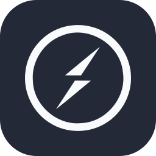  |
|  `spring`   |     |
| `supabase`  |   |
|  `symfony`  |    |
|  `uvicorn`  |    |
| `websocket` |  |
|  `workers`  |    |

### Banco de dados

|     Icon ID     |                         Icon                          |
| :-------------: | :---------------------------------------------------: |
|   `cassandra`   |      |
|   `dynamodb`    |       |
| `elasticsearch` |  |
|   `hibernate`   |      |
|    `mongodb`    |             |
|     `mysql`     |          |
|    `oracle`     |              |
|  `planetscale`  |    |
|   `postgres`    |     |
|    `prisma`     |              |
|     `redis`     |          |
|   `sequelize`   |      |
|      `sql`      |            |
|    `sqlite`     |              |

### DevOps e infraestrutura

|     Icon ID     |                         Icon                          |
| :-------------: | :---------------------------------------------------: |
|    `ansible`    |             |
|   `bitbucket`   |   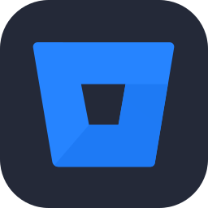   |
|    `docker`     |              |
|      `git`      |                 |
|    `github`     |         |
| `githubactions` |  |
|    `gitlab`     |         |
|    `grafana`    |        |
|     `ipfs`      |           |
|    `jenkins`    |        |
|  `kubernetes`   |          |
|      `nix`      |            |
|   `openshift`   |           |
|   `openstack`   |      |
|  `prometheus`   |          |
|    `sentry`     |              |
|   `terraform`   |      |

### Cloud e hospedagem

|   Icon ID    |                        Icon                        |
| :----------: | :------------------------------------------------: |
|    `aws`     |         |
|   `azure`    |       |
| `cloudflare` |  |
|    `gcp`     |         |
|   `heroku`   |           |
|  `netlify`   |     |
|   `render`   |     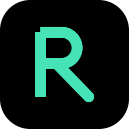      |
|   `replit`   |      |
|   `vercel`   |      |

### Testes e qualidade

|     Icon ID      |                          Icon                          |
| :--------------: | :----------------------------------------------------: |
|     `bandit`     |     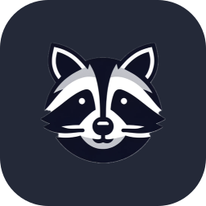     |
|     `biome`      |     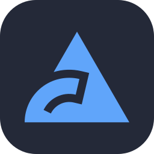      |
|    `cypress`     |         |
|     `eslint`     |       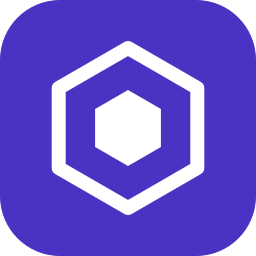        |
|    `golangci`    |    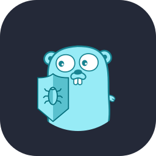    |
|     `husky`      |     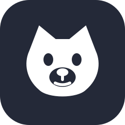      |
|      `jest`      |                 |
|   `playwright`   |   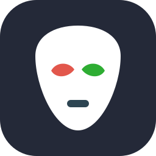   |
|    `postman`     |              |
|    `prettier`    |    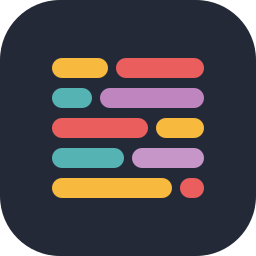    |
|     `radon`      |           |
|      `ruff`      |      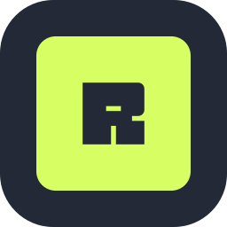      |
|    `selenium`    |             |
| `testinglibrary` |  |
|     `vitest`     |          |

### Mobile e desktop

|     Icon ID     |                         Icon                          |
| :-------------: | :---------------------------------------------------: |
| `androidstudio` |  |
|   `capacitor`   |     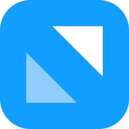      |
|   `electron`    |            |
|    `flutter`    |        |
|      `gtk`      |            |
|      `qt`       |             |
|     `tauri`     |          |

### IA e dados

|   Icon ID    |                        Icon                         |
| :----------: | :-------------------------------------------------: |
|  `anaconda`  |     |
|   `claude`   |       |
|   `gemini`   |       |
|  `jupyter`   |      |
|   `opencv`   |       |
| `openrouter` | 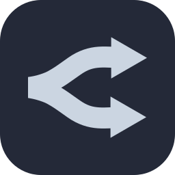  |
|  `pytorch`   |      |
|    `ros`     |          |
|  `sklearn`   |  |
| `tensorflow` |   |

### Jogos e 3D

|      Icon ID      |                        Icon                        |
| :---------------: | :------------------------------------------------: |
|      `bevy`       |        |
|     `blender`     |     |
| `gamemakerstudio` |  |
|      `godot`      |       |
|   `haxeflixel`    |  |
|  `robloxstudio`   |     |
|      `unity`      |       |
|     `unreal`      |     |

### Editores e IDEs

|    Icon ID     |                         Icon                         |
| :------------: | :--------------------------------------------------: |
|     `atom`     |               |
|    `clion`     |    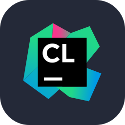     |
|   `codepen`    |       |
|   `eclipse`    |       |
|    `emacs`     |              |
|     `idea`     |          |
|    `neovim`    |        |
|   `phpstorm`   |   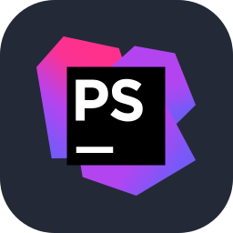   |
|   `pycharm`    |   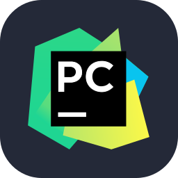    |
|    `rider`     |    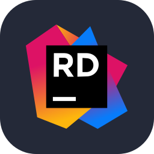     |
|   `sublime`    |   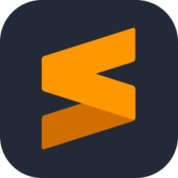    |
|     `vim`      |           |
| `visualstudio` |  |
|    `vscode`    |        |
|   `vscodium`   |      |
|   `webstorm`   |   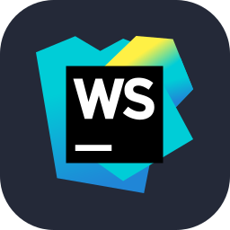   |

### Hardware

|    Icon ID    |                        Icon                         |
| :-----------: | :-------------------------------------------------: |
|   `arduino`   |           |
| `raspberrypi` |  |

### Design e criação

|    Icon ID    |                       Icon                       |
| :-----------: | :----------------------------------------------: |
|   `ableton`   |   |
|     `ae`      |   |
|     `ai`      |    |
|     `au`      |       |
|   `autocad`   |   |
|    `figma`    |     |
| `fontawesome` |    |
|     `pr`      |       |
|     `ps`      |      |
|  `sketchup`   |  |
|   `webflow`   |        |
|  `wordpress`  |      |
|     `xd`      |             |

### Sistemas operacionais

|  Icon ID  |                      Icon                       |
| :-------: | :---------------------------------------------: |
|  `apple`  |  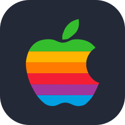  |
|  `arch`   |  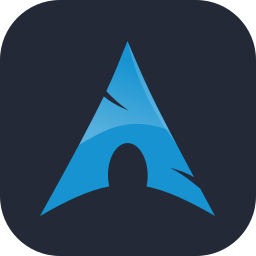   |
|   `bsd`   |      |
| `debian`  |   |
|  `kali`   |     |
|  `linux`  |    |
|  `mint`   |     |
|  `plan9`  |    |
| `redhat`  |   |
| `ubuntu`  |   |
| `windows` |  |

### Social e comunidades

|     Icon ID     |                         Icon                          |
| :-------------: | :---------------------------------------------------: |
|  `activitypub`  |    |
|     `bots`      |         |
|     `devto`     |          |
|    `discord`    |             |
|   `discordjs`   |      |
|   `fediverse`   |      |
|     `gmail`     |          |
|   `instagram`   |           |
|   `linkedin`    |            |
|   `mastodon`    |       |
|    `misskey`    |        |
|    `spotify`    |        |
| `stackoverflow` |  |
|    `twitter`    |             |

### Produtividade e outros

|  Icon ID   |                       Icon                       |
| :--------: | :----------------------------------------------: |
|   `azul`   |           |
|  `notion`  |  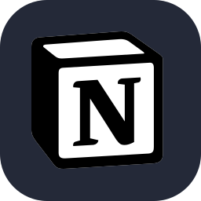  |
| `obsidian` | 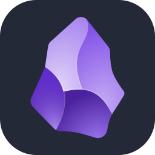 |

## Adicionar um ícone

1. Coloque o SVG em `icons/` seguindo as convenções abaixo.
2. Inclua o ID em uma categoria de `scripts/categories.mjs`.
3. Rode `npm run readme` para regenerar a [lista de ícones](#lista-de-ícones) e `npm test` para validar.

Convenções:

- `viewBox="0 0 256 256"`, `width`/`height` 256 e `fill="none"` na raiz;
- fundo `<rect width="256" height="256" rx="60">` e arte entre as coordenadas 41 e 215;
- par temático `Nome-Dark.svg` (fundo `#242938`) + `Nome-Light.svg` (fundo `#F4F2ED`), ou arquivo único quando o logo funciona sobre a cor da marca;
- **sem hífen no nome** além do sufixo de tema — o ID vem de `split('-')[0]`;
- **sem** `<text>`, `<style>`, `class=` ou referências externas (texto vira `<path>`);
- evite `id` e `<defs>`; se precisar, prefixe com o nome do ícone, pois todos são concatenados em um único SVG.

## Documentação complementar

| Documento                                                            | Conteúdo                                         |
| -------------------------------------------------------------------- | ------------------------------------------------ |
| [DEPLOY.md](DEPLOY.md)                                               | Publicar na Vercel ou no Cloudflare Workers      |
| [brand/README.md](brand/README.md)                                   | Especificação da marca `<gcruz.dev/>`            |
| [docs/BIBLIOTECA_DE_ANIMACOES.md](docs/BIBLIOTECA_DE_ANIMACOES.md)   | Modelos, arquitetura e validação das animações   |
| [docs/MEU_ARSENAL.md](docs/MEU_ARSENAL.md)                           | Coleção de animações exclusivas por tecnologia   |
| [docs/ATUALIZACAO_DO_CATALOGO.md](docs/ATUALIZACAO_DO_CATALOGO.md)   | Ícones incluídos na última ampliação do catálogo |
| [docs/INVENTARIO_TECNICO.md](docs/INVENTARIO_TECNICO.md)             | Inventário técnico do repositório                |
| [docs/ROADMAP_DE_IMPLEMENTACAO.md](docs/ROADMAP_DE_IMPLEMENTACAO.md) | Roadmap                                          |
| [licenses/README.md](licenses/README.md)                             | Origem e licença dos ícones de terceiros         |

## Créditos e licença

Este repositório é um fork de [skillicons.dev](https://skillicons.dev), criado por [tandpfun](https://github.com/tandpfun) sob licença MIT. Se o projeto original foi útil para você, considere apoiar o autor: [ko-fi.com/thijsdev](https://ko-fi.com/Q5Q860KQ2).

Os logotipos de terceiros são marcas de seus respectivos donos e aparecem apenas para identificação; origens e licenças adicionais estão em [`licenses/`](licenses/). A marca `<gcruz.dev/>` e os assets em `brand/` são de Guilherme Cruz. As fontes do site — [JetBrains Mono](https://github.com/JetBrains/JetBrainsMono) e [IBM Plex Sans](https://github.com/IBM/plex) — são auto-hospedadas sob a licença [OFL-1.1](https://openfontlicense.org).

Distribuído sob a licença MIT. Consulte o arquivo [LICENSE](LICENSE).
