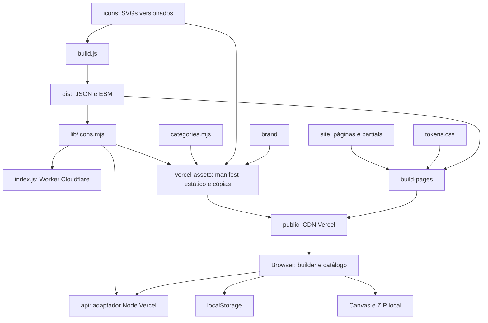

# Análise e plano de melhorias — skill-icons

> Registro histórico da auditoria inicial. As implementações posteriores estão em [ANIMACAO_DOS_ICONES.md](ANIMACAO_DOS_ICONES.md) e [ATUALIZACAO_DO_CATALOGO.md](ATUALIZACAO_DO_CATALOGO.md). Os achados e as contagens deste documento se referem à base auditada, não ao estado posterior às alterações.

**Repositório:** https://github.com/https-shini/skill-icons  
**Base auditada:** `main`, commit `6f6ed481f3cacc62b1a322e5ba19fa35958d28e3` (20/08/2026).  
**Data da análise:** 08/11/2026 (America/Sao_Paulo).  
**Escopo desta entrega:** documentação. Nenhum código-fonte, asset, manifesto de dependência, lockfile ou configuração foi alterado. Build criou apenas saídas ignoradas em `dist/` e `public/`. Ferramentas e ensaios auxiliares ficaram fora do repositório.

Convenções: **Encontrado** = evidência estática ou execução descrita; **Inferência** = consequência plausível ainda não medida; **Recomendação** = trabalho futuro. As linhas se referem ao commit acima. Prioridade é do projeto, não um escore CVSS. Nenhuma vulnerabilidade crítica remotamente explorável foi demonstrada. Os avisos de dependências são os retornados pelo registro na data da consulta, não confirmação de exploração.

## 1. Resumo executivo

O fork entrega 257 IDs de tecnologias e marca, com 433 arquivos SVG, 176 IDs temáticos, 81 sem tema e 44 aliases. O produto combina uma API de composição de SVG e um site estático em português com busca, seleção, snippets e downloads SVG/PNG/WebP/ZIP. A arquitetura é pequena, com JavaScript sem framework de UI e sem dependências de produção declaradas. Deve ser preservada.

O build e os verificadores atuais passaram; a matriz de responsividade passou em 180 combinações. A funcionalidade principal de seleção → URL → composição → preview → download foi verificada localmente. Isso não torna o projeto pronto para evolução sem controles: o workflow está inválido, a busca interpreta HTML, propriedades herdadas são aceitas como aliases, estado persistido inválido impede a inicialização e faltam testes de comportamento e limites de custo do renderizador.

Recomenda-se executar **26 melhorias**, distribuídas em oito fases no [roadmap](ROADMAP_DE_IMPLEMENTACAO.md). As primeiras entregas devem corrigir CI, entrada de dados, tratamento de erros e estado local, e atualizar a cadeia de ferramentas afetada por avisos conhecidos. Os trabalhos futuros devem manter o contrato público e a simplicidade operacional. A auditoria não publicou nenhuma mudança, não criou PR, não acessou segredos e não alterou infraestrutura.

## 2. Visão geral do projeto

| Dimensão            | Encontrado                                                                                                                       |
| ------------------- | -------------------------------------------------------------------------------------------------------------------------------- |
| Propósito           | Exibir tecnologias em README/currículo por URL de imagem e disponibilizar arquivos individuais                                   |
| Origem              | Fork de tandpfun/skill-icons, crédito e licença MIT preservados                                                                  |
| Usuários            | Quem monta badges e quem mantém catálogo/instância; papéis são de uso, não RBAC implementado                                     |
| Estado              | `package.json` versão 1.0.0; última alteração da base em agosto de 2026; não inferir release formal dessa versão                 |
| Armazenamento       | Assets em Git; dicionário gerado em dist; saída estática em public; preferências no localStorage `si:*`                          |
| Backend             | Funções Node Vercel e Worker Cloudflare compartilham `lib/icons.mjs`                                                             |
| Persistência remota | Não existe DB, ORM, filas ou uploads no código                                                                                   |
| Autenticação        | API e site públicos; sem contas, sessões, cookies de login ou autorização de aplicação                                           |
| Integrações         | Vercel/Cloudflare para hosting; GitHub Actions para automação; Clipboard, Canvas, Blob, CompressionStream e storage do navegador |

Ícones de serviços como bancos, provedores e ferramentas são conteúdo gráfico. Sua presença no catálogo **não é integração implementada** com esses produtos.

## 3. Arquitetura atual



### 3.1 Limites de responsabilidade

- `build.js` é CommonJS; produz mapa de conteúdo por nome em minúsculas. Não faz validação geral de assets.
- `lib/icons.mjs` é ESM e reúne dados, aliases, seleção de temas, composição e roteamento HTTP. O compartilhamento evita implementar o renderizador duas vezes.
- `api/_adapter.mjs` traduz req/res Node para Request/Response e força a rota de destino para lidar com o rewrite `/icons → /api/render`.
- `index.js` expõe fetch do Worker. Rotas não reconhecidas são passadas para `fetch(request)`; isso presume origem/configuração adequada e não serve o frontend gerado. Em workers.dev/custom domain, validar comportamento real antes de prometer fallback.
- O site é multipágina com composição em build time, partials comuns e módulos JavaScript do navegador. `public/` não deve ser editado à mão.
- O servidor local reproduz parte do roteamento, mas **não** os headers/cache, limites e semântica exata dos provedores.

### 3.2 Acoplamentos e duplicações

O principal acoplamento é metadados → módulo que carrega todos os SVGs → build obrigatório. O gerador de README contorna esse problema lendo aliases com regex do fonte. A classificação em `categories.mjs` e os aliases são reaproveitados no manifesto, o que é positivo. O tema é reaplicado no head e mantido por `tema.js`; a pequena duplicação evita flash inicial e não exige framework.

`api/manifest` e `/manifest.json` têm responsabilidades distintas: o primeiro é contrato público com nomes lógicos, o segundo contém arquivos reais, aliases e categorias para o frontend. Não os fundir sem compatibilidade. CSS tem separação por tokens/base/components/paginas; não há evidência de que CSS-in-JS ou migração para React tragam ganho. O builder de 378 linhas é o módulo frontend mais concentrado; extrair normalização e execução de exportação após testes é suficiente inicialmente.

## 4. Stack tecnológica

| Tecnologia         | Declaração/resolução                                     | Papel e avaliação                                                        |
| ------------------ | -------------------------------------------------------- | ------------------------------------------------------------------------ |
| JavaScript CJS/ESM | `.js` e `.mjs`, sem TypeScript                           | Backend, build e navegador; manter, considerar JSDoc/checkJs em evolução |
| Node.js            | CI 20; engines ausente; auditoria 24.22.1                | Build web usa import.meta.dirname; declarar mínimo real e LTS suportado  |
| HTML/CSS/SVG       | Sem framework frontend                                   | Seis páginas, tokens, layout responsivo e biblioteca de ícones           |
| Wrangler           | `^4.42.0` → lock 4.120.0                                 | CLI/ambiente Worker; avisos transitivos requerem triagem                 |
| Prettier           | `^3.6.2` → lock 3.9.6                                    | Formatação; check passou no fonte original                               |
| Yarn               | lockfile v1, sem packageManager                          | Instalação npm também é anunciada, sem package-lock; escolher convenção  |
| Vercel             | `vercel.json`, funções `api/`                            | Site estático + API; conta/runtime/produção não foram auditados          |
| Cloudflare         | `wrangler.toml`, compatibility_date 2026-08-01           | API Worker, workers_dev true; rota customizada comentada                 |
| Browser APIs       | Canvas, Clipboard, localStorage, Blob, CompressionStream | Conversão/ZIP local, com fallback ZIP sem compressão                     |
| Fontes             | JetBrains Mono e IBM Plex Sans, WOFF2 locais             | Auto-hospedadas; completar licença distribuída                           |

Inventário completo de scripts, endpoints e resoluções do lock: [INVENTARIO_TECNICO.md](INVENTARIO_TECNICO.md).

## 5. Mapeamento dos módulos

| Módulo                                               | Responsabilidade                                 | Dependências relevantes                              |
| ---------------------------------------------------- | ------------------------------------------------ | ---------------------------------------------------- |
| `icons/`                                             | 433 SVGs de 257 IDs                              | Convenção de nome, viewBox, temas e categorias       |
| `brand/`                                             | 28 SVGs e documentação da marca                  | Tokens e proveniência tipográfica                    |
| `build.js`                                           | Bundle de conteúdo                               | Filesystem local, executado na raiz                  |
| `lib/icons.mjs`                                      | Contrato HTTP/render/metadados                   | `dist/icons.mjs`, aliases internos                   |
| `api/` e `index.js`                                  | Entradas dos provedores                          | Handler compartilhado e APIs Web                     |
| `scripts/vercel-assets.mjs`                          | Cópia e manifesto enriquecido                    | Catálogo, aliases, categorias, arquivos reais        |
| `scripts/build-pages.mjs`                            | HTML, CSS combinado e cópias JS/fontes           | Partials, páginas, tokens e changelog                |
| `scripts/readme-table.mjs` e `categories.mjs`        | Tabela gerada, partição em 19 categorias         | readme.md minúsculo e regex de aliases               |
| `scripts/tokens.mjs`, `contraste.mjs`                | Extração e validação de paletas                  | Formato controlado de tokens.css                     |
| `scripts/normalizar-icones.mjs`                      | Fundo/canto de padrões conhecidos                | Não é sanitizador geral de SVG                       |
| `scripts/responsivo.mjs`                             | 6 × 15 × 2 verificações de layout                | Playwright opcional e Chromium externo               |
| `site/js/dados.js`                                   | Fetch e índice de busca                          | `/manifest.json`                                     |
| `site/js/builder.js`                                 | Estado, busca, seleção, preview e exportação     | dados/store/tema/download/toast e IDs do HTML        |
| `site/js/catalogo.js`, `marca.js`                    | Galerias e ações de cópia                        | Manifest estático, assets e clipboard                |
| `site/js/download.js`, `zip.js`                      | Conversão sequencial, salvamento e ZIP           | Canvas e formato ZIP próprio estreito                |
| `site/js/site.js`, `tema.js`, `store.js`, `toast.js` | Inicialização, overlays, preferências e feedback | DOM, módulos dinâmicos, storage tolerante a exceções |

## 6. Funcionalidades e regras identificadas

### 6.1 Fluxos existentes

1. **Compor badge:** `GET /icons?i=js,ts` → aliases canônicos → variante escura por padrão → SVG composto com 48px de lado visível por ícone e espaçamento escalonado. `perline` padrão 15, inteiro de 1 a 50. `i=all` inclui todos os IDs na ordem do catálogo. Ordem e repetições são preservadas.
2. **Buscar/selecionar:** manifest estático → categoria e busca normalizada sem acento → relevância (ID exato, alias, prefixo, substring) → seleção persistida → preview por URL da API. A UI segue tema do sistema ou escolha explícita.
3. **Exportar snippet:** Markdown, HTML ou URL com `location.origin`; tema claro entra na query, escuro usa default; formato de snippet não é persistido.
4. **Baixar:** um item produz arquivo direto; vários produzem ZIP; SVG mantém vetor original, PNG/WebP rasterizam no cliente. Resolução editável entre 16 e 1024px, presets 64/128/256/512. O lote continua em falhas individuais e informa IDs; sem sucesso lança erro.
5. **Navegar catálogo/marca:** copiar ID, URL ou SVG; páginas `/`, `/design-system`, `/marca`, `/changelog`, `/sobre` e HTML de 404. Não há painel administrativo nem adição de ícones via interface.
6. **Contribuir catálogo:** adicionar asset em Git, cadastrar categoria, gerar tabela e executar verificadores; build/deploy conforme provedor.

### 6.2 Contratos e detalhes que precisam ser preservados

`i` prevalece sobre `icons` quando não vazio; `t` prevalece sobre `theme` quando não vazio. IDs são sensíveis a caixa na API: `JS` dá 400, `js` resolve. Espaços não são removidos por item. `theme=` vazio cai no padrão; os aliases e o conjunto atual devem continuar válidos. As mensagens de erro esperadas são texto; transformar erros em JSON exige compatibilidade/versionamento.

Não há DB: relacionamentos, índices SQL, migrations, backups transacionais e sessão de usuário são **não aplicáveis** à base. Integridade relevante é a relação asset ↔ ID ↔ tema ↔ alias ↔ categoria. Recuperação depende de Git, deployment anterior, cache/CDN e storage local, não de dump de banco. Contas de provedores e secrets de publicação são controles externos à aplicação.

## 7. Diagnóstico técnico e validações executadas

### 7.1 Evidências verificáveis

| Evidência | Verificação e resultado                                                                                                                                   | Limite da conclusão                                                                                            |
| --------- | --------------------------------------------------------------------------------------------------------------------------------------------------------- | -------------------------------------------------------------------------------------------------------------- |
| E01       | 526 arquivos rastreados antes da entrega; inspeção de diretórios, fontes, scripts, configurações, assets e documentação                                   | Não inclui settings privados da conta, branch protection ou artefatos de produção                              |
| E02       | `node build.js`, vercel-assets e build-pages passaram; 433 arquivos, 257 IDs, 6 páginas; `readme:check`, `contraste:check`, `icones:check` passaram       | Build não valida deploy real; contraste avalia pares declarados, não conformidade WCAG completa                |
| E03       | actionlint 1.7.7 reprovou expressão de secrets na linha 44; runs mais recentes 32394881516, 32306630963, 32306477915 = failure; run da base tem zero jobs | Validador e histórico são evidências independentes; logs do runtime não existem para job não iniciado          |
| E04       | Busca recebeu HTML local com onerror que definiu window.auditXss=1                                                                                        | DOM injection executável local; não demonstrado vetor remoto por URL                                           |
| E05       | Handler direto: constructor e **proto** → 200 e undefined; js,py → 200; JS → 400; perline=0 → 400                                                         | Não houve alteração de protótipo nem exploração de infraestrutura                                              |
| E06       | Handler: all 1.553.571 B/~5ms; 1.000 js 1.188.181 B/~4ms em uma execução local                                                                            | Números pontuais, sem carga, sem percentis ou cold start de provedor                                           |
| E07       | Adaptador com host inválido → 500 com stack                                                                                                               | Entrada simulada; aceitação desse header pelo provedor não verificada                                          |
| E08       | localStorage si:selecao={} → zero tiles/toast; categoria linguagens → 46 itens, Todas marcado                                                             | Reprodução via manipulação controlada do storage, sem dados de usuário                                         |
| E09       | Servidor separado na porta 4174 encerrou com URIError após /%ZZ                                                                                           | Falha no servidor local; não transferir automaticamente para Vercel/Worker                                     |
| E10       | Yarn 1 audit consultou yarn.lock: 20 avisos, 8 altos/9 moderados/3 baixos                                                                                 | Ferramenta reportou todos como dev=false; a classificação real do package.json é devDependencies               |
| E11       | Leitura de fonte: regex de aliases e import de dist em módulos de metadados                                                                               | Débito estrutural; não falhou no build atual                                                                   |
| E12       | Parser XML aceitou 433 SVGs; varredura de conteúdo identificou imagens embutidas Firebase e IDs pattern0/pattern1 compartilhados pelas variantes          | Sem script ativo encontrado; varredura não substitui sanitizador; repetição de IDs não prova erro visual atual |
| E13       | Headers e nomes de arquivos lidos em vercel.json e geradores                                                                                              | Não foram medidos headers efetivos da CDN nem invalidation de conta                                            |
| E14       | Cache de dados só é preenchido após await; duas inicializações usam catalogo                                                                              | Corrida possível encontrada no código; duplicação de requisições remotas não foi medida                        |
| E15       | Download aplica data-loading sem disabled/guarda; nome de ZIP lê estado após await                                                                        | Concorrência e nome inconsistente inferidos do fluxo; sem teste de stress de múltiplos lotes                   |
| E16       | End na grade + filtro Linguagens → zero elementos tabindex=0                                                                                              | Falha de teclado reproduzida; leitor de tela não foi ensaiado                                                  |
| E17       | Catchs e preview inspecionados: erros de catálogo/marca só no console; cópia SVG não testa status                                                         | Rede offline e todos os erros de clipboard não foram automatizados nesta auditoria                             |
| E18       | Não há instrumentação operacional configurada no repositório                                                                                              | Hosting pode ter métricas próprias não acessíveis nesta análise                                                |
| E19       | Node 24.22.1/npm 11.9.0 usados; CI declara 20; sem engines/packageManager                                                                                 | Não executada matriz Node nem runtime de conta                                                                 |
| E20       | responsivo com Playwright externo/Chromium: 180 combinações passaram; fonte termina 0 quando runner não existe                                            | Só Chromium e estados iniciais; overlays abertos, zoom e leitor de tela não cobertos                           |
| E21       | Código da seleção não tem reordenação/import/export de coleção                                                                                            | Proposta de produto a validar com usuários                                                                     |
| E22       | Rotas/métodos/headers e dois manifestos inspecionados; adaptador GET e HEAD retornam 200 em simulação                                                     | Rede HTTP pode suprimir corpo HEAD; não extrapolar simulação para wire real                                    |
| E23       | MIT e avisos OFL por links presentes, textos OFL completos não encontrados                                                                                | A adequação legal e correspondência dos binários pedem revisão humana                                          |
| E24       | dist JSON 2.757.170 B; módulo ESM gzip 820.425 B; CSS combinado 35.807 B                                                                                  | gzip do módulo não é tamanho final de bundle Worker; limites de plano citados no DEPLOY não foram confirmados  |
| E25       | Gerador aponta literalmente para readme.md minúsculo                                                                                                      | Novo README.md é documentação de entrada; consolidação futura envolve código e está fora desta etapa           |
| E26       | Browser Chromium: 257 tiles, busca/seleção, imagem preview válida, download SVG/PNG/WebP e ZIP com JS+TS                                                  | Localhost; não garante clipboard HTTPS, Safari/Firefox ou deploy                                               |

### 7.2 Reprodução mínima, sem publicar mudanças

```bash
node build.js
node scripts/vercel-assets.mjs
node scripts/build-pages.mjs
node scripts/readme-table.mjs --check
node scripts/contraste.mjs --check
node scripts/normalizar-icones.mjs --check
node scripts/serve.mjs
```

Após iniciar o servidor, buscar `js`, selecionar JavaScript e baixar nos três formatos. No ensaio, PNG continha assinatura correta e dimensões 256×256; WebP continha cabeçalho RIFF/WEBP; ZIP de dois SVGs passou CRC via leitor independente Python (`ZipFile.testzip() = None`). Isso valida arquivos básicos, não toda a matriz de resoluções.

Para o problema de storage, usar DevTools em instância local descartável: `localStorage.setItem('si:selecao', '{}')`, recarregar e observar falha; remover somente essa chave após o teste. Para teclado, navegar até o último tile com End e escolher categoria menor. Não aplicar payloads ou carga de auditoria na instância pública.

O teste de layout foi executado com `PLAYWRIGHT_CORE` apontando para o módulo instalado fora do repo e `CHROMIUM=/usr/bin/chromium`, usando a sintaxe real `--base=http://localhost:4173`. `--base URL` aparece em comentário, mas não é aceito pelo parser atual. Prettier 3.9.6 passou no código original. O runner não foi adicionado ao package.json durante a auditoria.

### 7.3 Avaliação por disciplina

| Disciplina     | Pontos sólidos                                                                         | Lacunas específicas                                                                                    |
| -------------- | -------------------------------------------------------------------------------------- | ------------------------------------------------------------------------------------------------------ |
| Arquitetura    | Handler compartilhado, UI estática, tokens únicos, geração de assets                   | Módulo de metadados importa payload completo, regex de fonte, builder concentra estado/efeitos         |
| Performance    | CDN, lazy images, import dinâmico, fontes locais, CSS agregado, lote sequencial        | Composição sem teto, cache sem fingerprint, ausência de baseline operacional                           |
| Segurança      | Catálogo versionado, sem upload/DB/sessão, validação de tema/perline                   | DOM injection, aliases herdados, stack público, validação incompleta de assets e avisos em ferramentas |
| Dados          | Categoria particiona catálogo; manifesto exige duas variantes existentes               | Build não garante nomes/extensões/conteúdo seguro; storage valida JSON mas não esquema                 |
| UX/UI          | Identidade consistente, claro/escuro, busca por relevância, feedback toast e progresso | Filtro restaurado incorreto, foco perdido, recuperação de rede e estado sem orientação persistente     |
| Acessibilidade | Skip link, labels, foco visível, reduced-motion, focus trap básico e live region       | Tabs incompletos, fundo dos overlays sem inert, teste de layout não equivale a auditoria WCAG          |
| Confiabilidade | Separação de fonte/saída, validações determinísticas de catálogo e contraste           | Workflow inválido, sem suíte de comportamento, servidor dev cai em URI inválida, sem runbook/alerta    |

## 8. Problemas encontrados

Os itens abaixo são os problemas/limitações identificados. Descrição, localização, evidência, impacto, prioridade, solução e complexidade são detalhados nos cartões correspondentes da seção 10. Propostas de produto não são tratadas como defeitos.

| ID  | Diagnóstico                                                       | Natureza                                               | Prioridade |
| --- | ----------------------------------------------------------------- | ------------------------------------------------------ | ---------- |
| M01 | Workflow inválido antes de iniciar jobs                           | Encontrado                                             | alta       |
| M02 | HTML digitado executa na busca vazia                              | Encontrado; vetor local demonstrado                    | alta       |
| M03 | Propriedades herdadas passam por alias                            | Encontrado                                             | alta       |
| M04 | Custo do render sem teto de quantidade/bytes                      | Ausência encontrada; exaustão é risco inferido         | alta       |
| M05 | Stack em erro público                                             | Encontrado em adaptador simulado e no código Worker    | alta       |
| M06 | Storage com tipo inválido bloqueia montador                       | Encontrado                                             | alta       |
| M07 | URI inválida encerra servidor local                               | Encontrado                                             | média      |
| M08 | Avisos transitivos em ferramentas                                 | Encontrado no registro; atingibilidade não demonstrada | alta       |
| M09 | Suíte de comportamento inexistente                                | Encontrado                                             | alta       |
| M10 | Metadados acoplados ao bundle/regex de fonte                      | Encontrado                                             | média      |
| M11 | Validação incompleta de assets de contribuição                    | Encontrado; conteúdo malicioso atual não identificado  | alta       |
| M12 | Cache longo de URL mutável                                        | Encontrado; incoerência entre deploys não ensaiada     | média      |
| M13 | Cache não compartilha Promise em voo                              | Encontrado; impacto de tráfego não medido              | média      |
| M14 | Exportação não bloqueia concorrência                              | Encontrado no código; impacto de carga inferido        | média      |
| M15 | Filtro e foco divergentes; tabs incompletos                       | Encontrado/reproduzido                                 | alta       |
| M16 | Recuperação e erro visual incompletos                             | Encontrado no código                                   | média      |
| M17 | Operação não documentada/instrumentada no repo                    | Encontrado; settings externos desconhecidos            | média      |
| M18 | Runtime/instalação sem versão mínima uniforme                     | Encontrado                                             | média      |
| M19 | CI sem gate de PR e visual pode ser pulado                        | Encontrado                                             | alta       |
| M21 | Política de métodos/CORS e esquema sem contrato formal            | Limitação encontrada; depende de consumidores          | média      |
| M22 | Licença completa/proveniência de fontes incompleta no repo        | Encontrado; validação jurídica pendente                | média      |
| M24 | Convenção de README e documentação operacional precisam convergir | Encontrado; transição explicitada nesta entrega        | média      |
| M25 | Performance sem baseline reproduzível                             | Encontrado                                             | média      |
| M26 | Paridade de release e rollback sem evidência                      | Lacuna de validação                                    | alta       |

## 9. Débitos técnicos

1. **Contrato implícito:** aliases, ordem, dimensões, respostas textuais e diferenças de metadados vivem no código e em documentação editorial; testes devem torná-los verificáveis.
2. **Build dependente da ordem:** scripts de site importam dist; `npm run site` em checkout limpo exige primeiro `npm run build`. Extração de metadados reduz esse acoplamento sem trocar ferramentas.
3. **Ferramentas não reproduzíveis:** não existe engines/packageManager, Playwright é externo/opcional e wrangler-action recebe apenas versão major 4; não há lock efetivo do caminho de deploy CI.
4. **Estado de UI sem esquema:** wrapper de storage tolera bloqueio, mas inicialização e marcação dos controles não são derivadas de um estado normalizado.
5. **Segurança de contribuição:** normalização visual não cobre XML ativo, URLs externas, colisões e nomes novos. O catálogo é conteúdo confiável até uma contribuição ser incorporada.
6. **Evidências históricas sem processo:** comentários citam tempos, heap e limites cloud que não devem ser usados como SLO ou capacidade atual.

Não há evidência para classificar o projeto como monólito inadequado ou exigir microserviços, ORM, autenticação, Kubernetes, React ou TypeScript. Sem dependências runtime declaradas é uma vantagem real, mas não elimina dependências de infraestrutura, toolchain e navegador.

## 10. Melhorias recomendadas e especificações de implementação

Complexidade **baixa**: mudança localizada, em geral até 1–2 dias líquidos. **Média**: vários módulos/integração, aproximadamente 3–5 dias. **Alta**: desenho e piloto operacional, possivelmente 1–2 semanas. Faixas são ordens de grandeza, incluem validação básica e dependem de experiência/acesso; não constituem prazo contratado. Dependências referem-se aos IDs Mxx. Cada cartão define resultado esperado através do impacto a eliminar e dos critérios de aceite.

### M01 — Restabelecer o workflow do GitHub Actions

| Campo                                     | Especificação                                                                                                                                                                                                   |
| ----------------------------------------- | --------------------------------------------------------------------------------------------------------------------------------------------------------------------------------------------------------------- |
| Categoria                                 | Correção de funcionamento                                                                                                                                                                                       |
| Prioridade / complexidade                 | alta / baixa                                                                                                                                                                                                    |
| Situação atual / problema ou oportunidade | O passo Publish referencia secrets diretamente em if; só há triggers push na main e workflow_dispatch.                                                                                                          |
| Evidência e localização                   | E03; `.github/workflows/wrangler-action.yml:44`; actionlint 1.7.7: context "secrets" is not allowed here. O run do commit analisado falhou e tem zero jobs.                                                     |
| Impacto / resultado esperado              | As verificações declaradas não protegem alterações; publicação Cloudflare pelo workflow fica indisponível. Resultado: eliminar ou controlar esse impacto conforme aceite abaixo.                                |
| Proposta de solução                       | Disponibilizar o secret em env no escopo adequado e testar sua presença via env; não imprimir o valor. Exigir também account ID para publicar. Separar validação de deploy e exercitar cenário sem credenciais. |
| Arquivos/módulos envolvidos               | `.github/workflows/wrangler-action.yml`, `DEPLOY.md`                                                                                                                                                            |
| Dependências                              | nenhuma                                                                                                                                                                                                         |
| Riscos de implementação                   | Publicar por engano ao corrigir a condição; validar primeiro sem credenciais.                                                                                                                                   |
| Critérios de aceite                       | actionlint sem erros; workflow de validação executa os checks em PR; ausência de secrets pula somente publicação; presença é validada em ambiente autorizado.                                                   |

### M02 — Eliminar interpretação de HTML na busca

| Campo                                     | Especificação                                                                                                                                                                                                                        |
| ----------------------------------------- | ------------------------------------------------------------------------------------------------------------------------------------------------------------------------------------------------------------------------------------ |
| Categoria                                 | Segurança                                                                                                                                                                                                                            |
| Prioridade / complexidade                 | alta / baixa                                                                                                                                                                                                                         |
| Situação atual / problema ou oportunidade | A mensagem de resultado vazio interpola el.busca.value em innerHTML.                                                                                                                                                                 |
| Evidência e localização                   | E04; `site/js/builder.js:112`; payload local `` executou e definiu o marcador.                                                                                                                |
| Impacto / resultado esperado              | Execução de JavaScript na origem a partir da busca. Vetor demonstrado exige digitação/colagem pela própria pessoa; não foi demonstrado ataque remoto por link. Resultado: eliminar ou controlar esse impacto conforme aceite abaixo. |
| Proposta de solução                       | Construir a mensagem com nós DOM e textContent; reservar HTML estático para a ajuda. Revisar outras interpolações e adicionar regressão específica sem usar sanitização por regex.                                                   |
| Arquivos/módulos envolvidos               | `site/js/builder.js`, `site/js/dados.js`                                                                                                                                                                                             |
| Dependências                              | nenhuma                                                                                                                                                                                                                              |
| Riscos de implementação                   | Escapar duas vezes ou quebrar destaque da busca.                                                                                                                                                                                     |
| Critérios de aceite                       | Tags, aspas e entidades aparecem como texto; nenhum img/event handler é criado a partir da consulta; busca e destaque continuam funcionando.                                                                                         |

### M03 — Resolver apenas aliases próprios e válidos

| Campo                                     | Especificação                                                                                                                                                                                                  |
| ----------------------------------------- | -------------------------------------------------------------------------------------------------------------------------------------------------------------------------------------------------------------- |
| Categoria                                 | Correção de funcionamento                                                                                                                                                                                      |
| Prioridade / complexidade                 | alta / baixa                                                                                                                                                                                                   |
| Situação atual / problema ou oportunidade | parseShortNames usa name in shortNames, incluindo propriedades herdadas.                                                                                                                                       |
| Evidência e localização                   | E05; `lib/icons.mjs:109`; constructor e **proto** retornaram 200 com undefined no SVG.                                                                                                                         |
| Impacto / resultado esperado              | Quebra do contrato de erro para IDs inválidos; saída visual incorreta. Não caracteriza prototype pollution: não há escrita no protótipo. Resultado: eliminar ou controlar esse impacto conforme aceite abaixo. |
| Proposta de solução                       | Usar Object.hasOwn ou Map e confirmar que o nome resolvido existe no catálogo e que a variante está presente. Preservar aliases, ordem e repetições válidas.                                                   |
| Arquivos/módulos envolvidos               | `lib/icons.mjs`, futuros testes de contrato                                                                                                                                                                    |
| Dependências                              | nenhuma                                                                                                                                                                                                        |
| Riscos de implementação                   | Regressão nos 44 aliases ou nos ícones sem tema.                                                                                                                                                               |
| Critérios de aceite                       | constructor, **proto** e toString resultam 400; todos os aliases válidos resolvem nos dois temas; nenhuma saída contém undefined.                                                                              |

### M04 — Limitar custo de composição e entrada

| Campo                                     | Especificação                                                                                                                                                                                                                                                                                                 |
| ----------------------------------------- | ------------------------------------------------------------------------------------------------------------------------------------------------------------------------------------------------------------------------------------------------------------------------------------------------------------- |
| Categoria                                 | Segurança e performance                                                                                                                                                                                                                                                                                       |
| Prioridade / complexidade                 | alta / média                                                                                                                                                                                                                                                                                                  |
| Situação atual / problema ou oportunidade | Há validação de tema e perline, mas não há teto de itens repetidos, bytes de entrada ou saída.                                                                                                                                                                                                                |
| Evidência e localização                   | E06; `lib/icons.mjs:160`, generateSvg; 1.000 js produziram 1.188.181 bytes; i=all produziu 1.553.571 bytes em ensaio local.                                                                                                                                                                                   |
| Impacto / resultado esperado              | Amplificação de CPU, memória, resposta e custos em miss de cache. Não foi realizado teste de exaustão nem demonstrado DoS em produção. Resultado: eliminar ou controlar esse impacto conforme aceite abaixo.                                                                                                  |
| Proposta de solução                       | Definir limites a partir de M25; antecipar validação antes de montar strings; limitar quantidade e tamanho sem remover repetições silenciosamente. Manter all e catálogo atual; usar erro consistente (400/413) documentado. Rate limit só após medir tráfego e avaliar clientes GitHub por IP compartilhado. |
| Arquivos/módulos envolvidos               | `lib/icons.mjs`, adaptadores, documentação da API                                                                                                                                                                                                                                                             |
| Dependências                              | nenhuma; calibração por M25                                                                                                                                                                                                                                                                                   |
| Riscos de implementação                   | Novos limites podem rejeitar badges existentes; coletar amostras e divulgar o contrato.                                                                                                                                                                                                                       |
| Critérios de aceite                       | Limites explícitos com testes de fronteira N/N+1 e bytes; all continua 200; entrada rejeitada não entra na composição; medir memória e latência de casos limite.                                                                                                                                              |

### M05 — Padronizar erros públicos e diagnóstico privado

| Campo                                     | Especificação                                                                                                                                                                                                         |
| ----------------------------------------- | --------------------------------------------------------------------------------------------------------------------------------------------------------------------------------------------------------------------- |
| Categoria                                 | Segurança e confiabilidade                                                                                                                                                                                            |
| Prioridade / complexidade                 | alta / baixa                                                                                                                                                                                                          |
| Situação atual / problema ou oportunidade | Worker e adaptador Vercel devolvem err.stack ao cliente; não há log estruturado no servidor.                                                                                                                          |
| Evidência e localização                   | E07; `index.js:17`, `api/_adapter.mjs:51`; adaptador com host inválido retornou 500 contendo stack no ensaio isolado.                                                                                                 |
| Impacto / resultado esperado              | Divulgação de detalhes internos e dificuldade de investigar incidentes; host inválido pode ser filtrado pela hospedagem, o que não foi testado. Resultado: eliminar ou controlar esse impacto conforme aceite abaixo. |
| Proposta de solução                       | Devolver mensagem pública estável e ID de correlação; registrar detalhes somente no servidor sem query completa nem cabeçalhos sensíveis; normalizar validação de URL e respostas não cacheáveis de erro.             |
| Arquivos/módulos envolvidos               | `index.js`, `api/_adapter.mjs`, `lib/icons.mjs`                                                                                                                                                                       |
| Dependências                              | nenhuma                                                                                                                                                                                                               |
| Riscos de implementação                   | Perder diagnóstico ao ocultar stack sem log alternativo.                                                                                                                                                              |
| Critérios de aceite                       | Falha induzida não expõe caminhos/stack; log contém correlação e contexto mínimo; 400 de validação mantém compatibilidade; erros não herdam cache de sucesso.                                                         |

### M06 — Validar e normalizar estado persistido

| Campo                                     | Especificação                                                                                                                                                                                                 |
| ----------------------------------------- | ------------------------------------------------------------------------------------------------------------------------------------------------------------------------------------------------------------- |
| Categoria                                 | Estabilidade                                                                                                                                                                                                  |
| Prioridade / complexidade                 | alta / média                                                                                                                                                                                                  |
| Situação atual / problema ou oportunidade | store captura falhas de acesso/JSON, mas o builder presume array na seleção e aceita números/formato/categoria sem validar na restauração.                                                                    |
| Evidência e localização                   | E08; `site/js/store.js:26`, `site/js/builder.js:26`; si:selecao={} resulta zero tiles e toast de falha de catálogo.                                                                                           |
| Impacto / resultado esperado              | Estado antigo ou corrompido inutiliza o montador; valores fora de intervalo podem produzir URLs ou conversões inválidas. Resultado: eliminar ou controlar esse impacto conforme aceite abaixo.                |
| Proposta de solução                       | Criar normalizador puro com Array.isArray, IDs conhecidos únicos, enum svg/png/webp, categoria válida, inteiros e limites; defaults seguros por campo; versionar esquema si: sem apagar preferências válidas. |
| Arquivos/módulos envolvidos               | `site/js/store.js`, `site/js/builder.js`                                                                                                                                                                      |
| Dependências                              | nenhuma                                                                                                                                                                                                       |
| Riscos de implementação                   | Limpeza excessiva de seleções legítimas; migração de estado precisa ser reversível.                                                                                                                           |
| Critérios de aceite                       | null, {}, strings, arrays mistos, números não finitos e versões anteriores não impedem inicialização; seleção válida, tema e ordem são preservados; testes cobrem intervalos 1–50 e 16–1024.                  |

### M07 — Tornar o servidor de desenvolvimento resiliente

| Campo                                     | Especificação                                                                                                                                                                                                                      |
| ----------------------------------------- | ---------------------------------------------------------------------------------------------------------------------------------------------------------------------------------------------------------------------------------- |
| Categoria                                 | Confiabilidade local                                                                                                                                                                                                               |
| Prioridade / complexidade                 | média / baixa                                                                                                                                                                                                                      |
| Situação atual / problema ou oportunidade | decodeURIComponent e handler async não têm fronteira de exceção; contenção usa startsWith(PUBLIC); listen não fixa loopback.                                                                                                       |
| Evidência e localização                   | E09; `scripts/serve.mjs:35,38,52,71`; GET /%ZZ encerrou processo de teste com URIError e exit 1.                                                                                                                                   |
| Impacto / resultado esperado              | Uma URL malformada interrompe a sessão local. Comparação por prefixo textual é proteção frágil contra caminhos irmãos; leitura indevida não foi demonstrada. Resultado: eliminar ou controlar esse impacto conforme aceite abaixo. |
| Proposta de solução                       | Capturar erros por requisição e de streams; devolver 400/500 sem encerrar servidor; verificar contenção via path.relative e fronteira de diretório; bind local por padrão; documentar que não é servidor de produção.              |
| Arquivos/módulos envolvidos               | `scripts/serve.mjs`                                                                                                                                                                                                                |
| Dependências                              | nenhuma                                                                                                                                                                                                                            |
| Riscos de implementação                   | Mudar bind pode afetar previews remotos; oferecer configuração explícita se necessária.                                                                                                                                            |
| Critérios de aceite                       | /%ZZ retorna 400 e a próxima requisição normal retorna 200; caminhos codificados não saem de public; falha de stream não derruba processo; testes de contenção.                                                                    |

### M08 — Corrigir avisos de segurança da cadeia de ferramentas

| Campo                                     | Especificação                                                                                                                                                                                                                                                                         |
| ----------------------------------------- | ------------------------------------------------------------------------------------------------------------------------------------------------------------------------------------------------------------------------------------------------------------------------------------- |
| Categoria                                 | Atualização tecnológica urgente                                                                                                                                                                                                                                                       |
| Prioridade / complexidade                 | alta / média                                                                                                                                                                                                                                                                          |
| Situação atual / problema ou oportunidade | yarn.lock resolve Wrangler 4.120.0, sharp 0.35.2 e undici 7.29.0 por miniflare.                                                                                                                                                                                                       |
| Evidência e localização                   | E10; yarn audit do lock em 08/11/2026: 20 avisos (8 altos, 9 moderados, 3 baixos), distribuídos entre sharp e undici.                                                                                                                                                                 |
| Impacto / resultado esperado              | Risco em ferramentas locais/CI conforme operações atingíveis; não há importação de sharp/undici no runtime da aplicação. Exploração efetiva não foi validada. Resultado: eliminar ou controlar esse impacto conforme aceite abaixo.                                                   |
| Proposta de solução                       | Atualizar Wrangler dentro da linha compatível e regenerar lock com um gerenciador definido; confirmar transitivas corrigidas (sharp >=0.35.5 e undici >=7.30.1 para os avisos consultados). Preferir atualização do pacote pai a overrides; repetir audit e dry-run antes de release. |
| Arquivos/módulos envolvidos               | `package.json`, `yarn.lock`, workflow                                                                                                                                                                                                                                                 |
| Dependências                              | nenhuma                                                                                                                                                                                                                                                                               |
| Riscos de implementação                   | Mudanças no bundler, compatibilidade Worker ou binários opcionais; não aplicar audit fix --force indiscriminadamente.                                                                                                                                                                 |
| Critérios de aceite                       | Novo lock reproduzível; avisos identificados resolvidos ou exceção documentada com análise de atingibilidade, responsável e expiração; build, servidor e dry-run Worker passam.                                                                                                       |

### M09 — Estabelecer testes de comportamento e contratos

| Campo                                     | Especificação                                                                                                                                                                                                                           |
| ----------------------------------------- | --------------------------------------------------------------------------------------------------------------------------------------------------------------------------------------------------------------------------------------- |
| Categoria                                 | Fundação técnica                                                                                                                                                                                                                        |
| Prioridade / complexidade                 | alta / média                                                                                                                                                                                                                            |
| Situação atual / problema ou oportunidade | Não há script test nem suíte de unidade/integração; há verificadores de dados, tokens e layout.                                                                                                                                         |
| Evidência e localização                   | E01/E02; package.json e árvore rastreada; nomes Jest/Vitest/Playwright em icons/ são assets, não frameworks instalados.                                                                                                                 |
| Impacto / resultado esperado              | Refatorações podem quebrar API, persistência ou exportação sem detecção automática. Resultado: eliminar ou controlar esse impacto conforme aceite abaixo.                                                                               |
| Proposta de solução                       | Adotar node:test para núcleo/ZIP/normalização e testes de adaptadores, com fixtures pequenas e cenários de erro; browser runner fixado para fluxos reais. Extrair funções puras só onde necessário. Não trocar stack para obter testes. |
| Arquivos/módulos envolvidos               | `lib/icons.mjs`, `api/`, `site/js/`, futuros `tests/`, `package.json`                                                                                                                                                                   |
| Dependências                              | M01                                                                                                                                                                                                                                     |
| Riscos de implementação                   | Snapshots grandes e frágeis ou métricas de cobertura que não demonstram comportamento.                                                                                                                                                  |
| Critérios de aceite                       | Comando de testes documentado e executado em PR; cada bug M02–M08 tem regressão; contrato de aliases, temas, ordem, erros, dimensões e bytes de exportação coberto.                                                                     |

### M10 — Separar metadados do carregamento de SVGs

| Campo                                     | Especificação                                                                                                                                                                                                 |
| ----------------------------------------- | ------------------------------------------------------------------------------------------------------------------------------------------------------------------------------------------------------------- |
| Categoria                                 | Arquitetura e organização                                                                                                                                                                                     |
| Prioridade / complexidade                 | média / média                                                                                                                                                                                                 |
| Situação atual / problema ou oportunidade | shortNames vive no módulo que importa todos os SVGs; readme-table extrai aliases por regex do fonte para evitar depender de dist.                                                                             |
| Evidência e localização                   | E11; `lib/icons.mjs:11`, `scripts/readme-table.mjs:48`, `scripts/vercel-assets.mjs:24`, `scripts/build-pages.mjs:20`.                                                                                         |
| Impacto / resultado esperado              | Acoplamento de ferramentas ao formato textual do código e à ordem de build; refatoração pode esvaziar aliases sem erro semântico claro. Resultado: eliminar ou controlar esse impacto conforme aceite abaixo. |
| Proposta de solução                       | Extrair metadados canônicos leves para ESM importável sem dist; gerar manifestos da mesma fonte, mantendo nomes e categorias. Separar catálogo e renderização de forma incremental, sem novos serviços.       |
| Arquivos/módulos envolvidos               | `lib/`, `scripts/readme-table.mjs`, `scripts/vercel-assets.mjs`, `scripts/build-pages.mjs`                                                                                                                    |
| Dependências                              | M09                                                                                                                                                                                                           |
| Riscos de implementação                   | Reordenação involuntária do catálogo ou aliases; ciclos de importação.                                                                                                                                        |
| Critérios de aceite                       | Gerador de tabela funciona antes de dist existir; nenhuma regex lê JS para obter aliases; API e manifestos mantêm IDs/campos/ordem contratados; checks de categorias passam.                                  |

### M11 — Validar assets SVG e integridade de catálogo

| Campo                                     | Especificação                                                                                                                                                                                                                                                                                                                                                                |
| ----------------------------------------- | ---------------------------------------------------------------------------------------------------------------------------------------------------------------------------------------------------------------------------------------------------------------------------------------------------------------------------------------------------------------------------- |
| Categoria                                 | Segurança e integridade                                                                                                                                                                                                                                                                                                                                                      |
| Prioridade / complexidade                 | alta / média                                                                                                                                                                                                                                                                                                                                                                 |
| Situação atual / problema ou oportunidade | build.js lê todo arquivo do diretório sem filtrar extensão/validar SVG; normalizador trata apenas padrões específicos de fundo/canto.                                                                                                                                                                                                                                        |
| Evidência e localização                   | E12; `build.js:3–8`, `scripts/normalizar-icones.mjs`; 433 XMLs bem formados; Firebase usa imagens data: e pattern0/pattern1, que exigem política compatível.                                                                                                                                                                                                                 |
| Impacto / resultado esperado              | Uma contribuição pode introduzir conteúdo ativo, referências externas, nomes colidentes ou par temático incompleto. Nenhum script ativo foi identificado nos assets inspecionados. Resultado: eliminar ou controlar esse impacto conforme aceite abaixo.                                                                                                                     |
| Proposta de solução                       | Gate de entrada com parser XML seguro sem resolução externa: allowlist compatível com assets atuais, proibir scripts/eventos/foreignObject e URL de rede; permitir explicitamente raster embutido necessário. Validar extensão, nome, lower-case collisions, viewBox, pares, categorias e aliases; tratar IDs/referências por ocorrência se composição precisar desambiguar. |
| Arquivos/módulos envolvidos               | `build.js`, `icons/`, `scripts/`, `lib/icons.mjs`                                                                                                                                                                                                                                                                                                                            |
| Dependências                              | M09, M10                                                                                                                                                                                                                                                                                                                                                                     |
| Riscos de implementação                   | Sanitização destrutiva pode remover gradientes/imagens legítimos; IDs repetidos só entre variantes iguais não provam defeito visual atual.                                                                                                                                                                                                                                   |
| Critérios de aceite                       | Todos os assets atuais passam sem alteração visual injustificada; fixtures maliciosas ou inconsistentes falham antes do bundle; XML externo não é resolvido; testes visuais de gradientes e ícones repetidos passam.                                                                                                                                                         |

### M12 — Versionar assets e alinhar cache ao deploy

| Campo                                     | Especificação                                                                                                                                                                                                                                           |
| ----------------------------------------- | ------------------------------------------------------------------------------------------------------------------------------------------------------------------------------------------------------------------------------------------------------- |
| Categoria                                 | Performance e consistência                                                                                                                                                                                                                              |
| Prioridade / complexidade                 | média / média                                                                                                                                                                                                                                           |
| Situação atual / problema ou oportunidade | URLs estáveis de fontes são immutable por um ano; SVGs têm s-maxage de um ano; manifest/CSS/JS têm políticas e durações diferentes.                                                                                                                     |
| Evidência e localização                   | E13; `vercel.json:8–57`, `lib/icons.mjs:71–75`; nomes não contêm hash de conteúdo.                                                                                                                                                                      |
| Impacto / resultado esperado              | Atualização pode combinar manifest novo com asset antigo. Cache reduz custo, mas rollback e propagação precisam de contrato explícito. Resultado: eliminar ou controlar esse impacto conforme aceite abaixo.                                            |
| Proposta de solução                       | Adicionar fingerprints ou caminhos versionados aos assets internos e ao manifest; manter URLs públicas legadas; versionar referências do build e definir retenção/purge. Não usar immutable em URL cujo conteúdo muda; provar headers reais em preview. |
| Arquivos/módulos envolvidos               | `vercel.json`, geradores, `site/partials/head.html`, consumidores de manifest                                                                                                                                                                           |
| Dependências                              | M09, M10, M25                                                                                                                                                                                                                                           |
| Riscos de implementação                   | Invalidar todos os caches aumenta cold traffic; remoção precoce de versões quebra HTML em cache.                                                                                                                                                        |
| Critérios de aceite                       | Dois deploys consecutivos e rollback carregam conjuntos coerentes; URLs antigas ainda funcionam; cache hit/miss e revalidação medidos; frontend não mistura versões.                                                                                    |

### M13 — Compartilhar requisições concorrentes do manifesto

| Campo                                     | Especificação                                                                                                                                                                                                   |
| ----------------------------------------- | --------------------------------------------------------------------------------------------------------------------------------------------------------------------------------------------------------------- |
| Categoria                                 | Performance                                                                                                                                                                                                     |
| Prioridade / complexidade                 | média / baixa                                                                                                                                                                                                   |
| Situação atual / problema ou oportunidade | catalogo guarda somente resultado concluído; builder e catálogo iniciam por imports independentes.                                                                                                              |
| Evidência e localização                   | E14; `site/js/dados.js:9–24`, `site/js/site.js:111–126`; existe janela lógica de duas chamadas antes de cache ser definido; duplicação de tráfego de rede depende do cache do navegador e não foi quantificada. |
| Impacto / resultado esperado              | Possível parsing/fetch duplicado e divergência de recuperação em falhas; catálogo pequeno não justifica virtualização agora. Resultado: eliminar ou controlar esse impacto conforme aceite abaixo.              |
| Proposta de solução                       | Memorizar Promise em voo; compartilhar resultado; limpar Promise após rejeição para permitir retry. Evitar cache persistente adicional sem evidência.                                                           |
| Arquivos/módulos envolvidos               | `site/js/dados.js`                                                                                                                                                                                              |
| Dependências                              | M09, M25                                                                                                                                                                                                        |
| Riscos de implementação                   | Rejeição memorizada permanentemente inutilizaria novas tentativas.                                                                                                                                              |
| Critérios de aceite                       | Duas chamadas concorrentes usam um fetch; falha é compartilhada; nova chamada após falha tenta novamente; busca mantém ordenação.                                                                               |

### M14 — Controlar exportações e preservar opções do lote

| Campo                                     | Especificação                                                                                                                                                                                                                                       |
| ----------------------------------------- | --------------------------------------------------------------------------------------------------------------------------------------------------------------------------------------------------------------------------------------------------- |
| Categoria                                 | Melhoria funcional e estabilidade                                                                                                                                                                                                                   |
| Prioridade / complexidade                 | média / média                                                                                                                                                                                                                                       |
| Situação atual / problema ou oportunidade | Lote é sequencial e libera canvas, mas botão ganha só data-loading; não fica disabled e não há guarda de execução/cancelamento.                                                                                                                     |
| Evidência e localização                   | E15; `site/js/builder.js:317–360`, `site/css/components.css:52`; controles continuam editáveis e nome final usa estado.formato após await.                                                                                                          |
| Impacto / resultado esperado              | Cliques concorrentes podem criar lotes simultâneos; alterar formato durante o lote pode gerar nome incoerente; arquivo ZIP acumula bytes em memória. Resultado: eliminar ou controlar esse impacto conforme aceite abaixo.                          |
| Proposta de solução                       | Snapshot imutável das opções no início, trava de execução inclusive no download único, aria-busy e bloqueio/restauração dos controles apropriados; cancelamento cooperativo entre itens; conservar relatório de falhas e validar MIME real de WebP. |
| Arquivos/módulos envolvidos               | `site/js/builder.js`, `site/js/download.js`, `site/js/zip.js`                                                                                                                                                                                       |
| Dependências                              | M06, M09                                                                                                                                                                                                                                            |
| Riscos de implementação                   | Cancelar pode perder itens já convertidos; definir se resultado parcial é baixado e garantir finally.                                                                                                                                               |
| Critérios de aceite                       | Cliques rápidos produzem um trabalho; opções e nome do arquivo correspondem; cancelamento libera UI e memória; PNG/WebP/ZIP íntegros; falha parcial informa IDs afetados.                                                                           |

### M15 — Sincronizar filtros, foco e semântica acessível

| Campo                                     | Especificação                                                                                                                                                                                                                                                                                        |
| ----------------------------------------- | ---------------------------------------------------------------------------------------------------------------------------------------------------------------------------------------------------------------------------------------------------------------------------------------------------- |
| Categoria                                 | UX/UI e acessibilidade                                                                                                                                                                                                                                                                               |
| Prioridade / complexidade                 | alta / média                                                                                                                                                                                                                                                                                         |
| Situação atual / problema ou oportunidade | Filtro salvo não inicializa aria-pressed; ativo não é reajustado ao filtrar; tabs não implementam navegação/composição completa do padrão ARIA.                                                                                                                                                      |
| Evidência e localização                   | E08/E16; `site/js/builder.js:58,75,134,263`, `site/pages/index.html:92`; categoria linguagens restaurou 46 resultados com Todas marcado; End na grade seguido de Linguagens deixou zero tabindex=0.                                                                                                  |
| Impacto / resultado esperado              | Feedback visual contraditório e grade deixa de ter ponto de entrada por Tab; leitores de tela recebem tabs sem painel associado. Resultado: eliminar ou controlar esse impacto conforme aceite abaixo.                                                                                               |
| Proposta de solução                       | Derivar aria-pressed do estado no primeiro render; ajustar ativo a cada mudança de lista e preservar foco ao trocar tema; decidir entre botões de seleção simples ou tabs completos com painel/aria-controls e setas. Revisar isolamento de fundo com inert em overlays e testar com leitor de tela. |
| Arquivos/módulos envolvidos               | `site/js/builder.js`, `site/js/site.js`, `site/pages/index.html`, CSS                                                                                                                                                                                                                                |
| Dependências                              | M06, M09                                                                                                                                                                                                                                                                                             |
| Riscos de implementação                   | Captura de foco agressiva pode interromper digitação; inert precisa ser revertido sempre.                                                                                                                                                                                                            |
| Critérios de aceite                       | Filtro marcado coincide com lista após reload; toda lista não vazia tem um tabindex=0; teclado percorre/seleciona/sai da grade; sem violações graves no scanner e aprovação manual de foco e leitura.                                                                                                |

### M16 — Oferecer recuperação de falha no frontend

| Campo                                     | Especificação                                                                                                                                                                                                                          |
| ----------------------------------------- | -------------------------------------------------------------------------------------------------------------------------------------------------------------------------------------------------------------------------------------- |
| Categoria                                 | UX/UI e confiabilidade                                                                                                                                                                                                                 |
| Prioridade / complexidade                 | média / média                                                                                                                                                                                                                          |
| Situação atual / problema ou oportunidade | Builder mostra toast genérico; catálogo/marca registram somente console; preview não trata erro; marca copia resposta sem testar r.ok.                                                                                                 |
| Evidência e localização                   | E17; `site/js/site.js:111–131`, `site/js/builder.js:255`, `site/js/marca.js:151–153`; página tem Carregando sem estado durável de erro.                                                                                                |
| Impacto / resultado esperado              | Falhas de rede deixam áreas vazias ou estado de carregamento; copiar uma página 404 pode parecer sucesso. Resultado: eliminar ou controlar esse impacto conforme aceite abaixo.                                                        |
| Proposta de solução                       | Estados loading/empty/error/retry por seção com mensagens acionáveis; verificar status antes de copiar SVG; tratamento de erro do preview; manter conteúdo editorial acessível sem JS e explicar dependência do montador com noscript. |
| Arquivos/módulos envolvidos               | `site/js/site.js`, `site/js/dados.js`, `site/js/marca.js`, `site/js/builder.js`, `site/pages/index.html`                                                                                                                               |
| Dependências                              | M09, M13, M15                                                                                                                                                                                                                          |
| Riscos de implementação                   | Retry concorrente e mensagens duplicadas entre módulos.                                                                                                                                                                                |
| Critérios de aceite                       | Bloquear manifest e depois restaurar rede permite retomar sem reload; 404 de marca não copia HTML; preview com falha informa problema; JS desabilitado recebe orientação clara.                                                        |

### M17 — Definir observabilidade mínima e recuperação operacional

| Campo                                     | Especificação                                                                                                                                                                                                           |
| ----------------------------------------- | ----------------------------------------------------------------------------------------------------------------------------------------------------------------------------------------------------------------------- |
| Categoria                                 | Confiabilidade e operação                                                                                                                                                                                               |
| Prioridade / complexidade                 | média / média                                                                                                                                                                                                           |
| Situação atual / problema ou oportunidade | Não há configuração de métricas, alertas, runbooks de incidente ou logs estruturados na aplicação.                                                                                                                      |
| Evidência e localização                   | E18; entradas index.js/api e configurações rastreadas; serviços de monitoramento externos eventualmente ativados não são visíveis no repo.                                                                              |
| Impacto / resultado esperado              | Erros e custos podem crescer sem detecção; recuperar domínio, deployment e cache exige conhecimento tácito. Resultado: eliminar ou controlar esse impacto conforme aceite abaixo.                                       |
| Proposta de solução                       | Medir status/latência/erros por rota e versão sem consultas completas; smoke periódico de SVG e manifest; alertas simples com responsável e runbook de rollback/purge. Usar primeiro recursos existentes da hospedagem. |
| Arquivos/módulos envolvidos               | `api/_adapter.mjs`, `index.js`, workflow, futura documentação operacional                                                                                                                                               |
| Dependências                              | M05, M25                                                                                                                                                                                                                |
| Riscos de implementação                   | Logs podem registrar dados desnecessários e elevar custos; definir retenção/amostragem.                                                                                                                                 |
| Critérios de aceite                       | Falha sintética dispara alerta em staging; requisição é correlacionável; runbook permite promover versão anterior e validar API; não há secrets/query completa nos logs.                                                |

### M18 — Fixar toolchain e validar runtimes suportados

| Campo                                     | Especificação                                                                                                                                                                                                                                                                             |
| ----------------------------------------- | ----------------------------------------------------------------------------------------------------------------------------------------------------------------------------------------------------------------------------------------------------------------------------------------- |
| Categoria                                 | Atualização tecnológica                                                                                                                                                                                                                                                                   |
| Prioridade / complexidade                 | média / média                                                                                                                                                                                                                                                                             |
| Situação atual / problema ou oportunidade | Sem engines/packageManager; CI usa Node 20; build web usa import.meta.dirname; há yarn.lock v1 e instalação npm também documentada.                                                                                                                                                       |
| Evidência e localização                   | E19; package.json, workflow linha 18, scripts; ambiente desta auditoria Node 24.22.1. Node 20 inicial não fornece import.meta.dirname; suporte mínimo exato não está declarado.                                                                                                           |
| Impacto / resultado esperado              | Comandos podem funcionar em uma máquina e falhar em outra; instalação npm não usa resoluções do yarn.lock. Resultado: eliminar ou controlar esse impacto conforme aceite abaixo.                                                                                                          |
| Proposta de solução                       | Escolher Node LTS suportado pelas duas hospedagens (candidato Node 24, já ensaiado localmente), registrar engines e versão do gerenciador, alinhar CI/hosting/local. Revisar compatibility_date do Worker separadamente; atualizar ferramentas em PR próprio com release notes e dry-run. |
| Arquivos/módulos envolvidos               | `package.json`, `yarn.lock`, workflow, `wrangler.toml`, README/DEPLOY                                                                                                                                                                                                                     |
| Dependências                              | M08, M09                                                                                                                                                                                                                                                                                  |
| Riscos de implementação                   | Node escolhido pode não estar configurado na conta de hospedagem; major do Wrangler pode mudar bundle.                                                                                                                                                                                    |
| Critérios de aceite                       | Instalação congelada em checkout limpo produz mesmo lock; matriz do runtime escolhido passa; nenhum comando anunciado depende de APIs ausentes; runtime real de preview confirmado.                                                                                                       |

### M19 — Tornar validações obrigatórias e reproduzíveis

| Campo                                     | Especificação                                                                                                                                                                                                                                                                                   |
| ----------------------------------------- | ----------------------------------------------------------------------------------------------------------------------------------------------------------------------------------------------------------------------------------------------------------------------------------------------- |
| Categoria                                 | Qualidade e CI                                                                                                                                                                                                                                                                                  |
| Prioridade / complexidade                 | alta / média                                                                                                                                                                                                                                                                                    |
| Situação atual / problema ou oportunidade | Workflow não roda em pull_request; responsivo termina com exit 0 se runner ausente e não integra CI; browser depende de caminho absoluto do Chromium.                                                                                                                                           |
| Evidência e localização                   | E20; `.github/workflows/wrangler-action.yml:3–8`, `scripts/responsivo.mjs:44,93`; prettier passou localmente, mas format:check não está no workflow.                                                                                                                                            |
| Impacto / resultado esperado              | Uma execução verde pode pular o teste visual; regressões chegam à main antes de validação automática. Resultado: eliminar ou controlar esse impacto conforme aceite abaixo.                                                                                                                     |
| Proposta de solução                       | Introduzir validação em PR com permissões mínimas, actionlint, install congelado, formato, testes, checks de dados e build; fixar browser runner e falhar quando esperado estiver ausente. Configurar checks obrigatórios na branch com responsável humano; fixar actions por SHA após revisão. |
| Arquivos/módulos envolvidos               | workflow, `scripts/responsivo.mjs`, `package.json`, configuração GitHub                                                                                                                                                                                                                         |
| Dependências                              | M01, M09, M11, M18                                                                                                                                                                                                                                                                              |
| Riscos de implementação                   | PRs de forks não têm secrets; testes não devem depender deles nem publicar código externo.                                                                                                                                                                                                      |
| Critérios de aceite                       | PR inválido é bloqueado antes de merge; runner ausente falha no job obrigatório; nenhuma publicação em PR; 180 combinações e fluxos essenciais têm evidência anexada.                                                                                                                           |

### M20 — Compartilhar e reorganizar seleções

| Campo                                     | Especificação                                                                                                                                                                                                |
| ----------------------------------------- | ------------------------------------------------------------------------------------------------------------------------------------------------------------------------------------------------------------ |
| Categoria                                 | Melhoria funcional futura                                                                                                                                                                                    |
| Prioridade / complexidade                 | baixa / média                                                                                                                                                                                                |
| Situação atual / problema ou oportunidade | Seleção é uma lista local e snippets refletem a ordem dos cliques; não existe importação de coleção ou reordenação explícita.                                                                                |
| Evidência e localização                   | E21; `site/js/builder.js`, store; recomendação de produto, não defeito atual.                                                                                                                                |
| Impacto / resultado esperado              | Compartilhar uma stack ou ajustar ordem exige selecionar novamente. Resultado: eliminar ou controlar esse impacto conforme aceite abaixo.                                                                    |
| Proposta de solução                       | Adicionar reordenação por botões acessíveis e importar/exportar seleção com esquema versionado; opcionalmente estado em fragmento de URL com validação, limites e nenhum HTML. Não exigir conta nem backend. |
| Arquivos/módulos envolvidos               | `site/js/builder.js`, `site/js/store.js`, página principal                                                                                                                                                   |
| Dependências                              | M02, M04, M06, M15, M26                                                                                                                                                                                      |
| Riscos de implementação                   | Estado compartilhado passa a ser entrada remota; prevenir XSS, URLs excessivas e substituição inesperada da seleção.                                                                                         |
| Critérios de aceite                       | Export/import preserva ordem e tema; IDs inválidos têm feedback; teclado reordena; estado em link não executa código nem excede teto; cancelar importação conserva estado anterior.                          |

### M21 — Formalizar métodos, CORS e esquema da API

| Campo                                     | Especificação                                                                                                                                                                                                                                                                    |
| ----------------------------------------- | -------------------------------------------------------------------------------------------------------------------------------------------------------------------------------------------------------------------------------------------------------------------------------- |
| Categoria                                 | Contrato e integração                                                                                                                                                                                                                                                            |
| Prioridade / complexidade                 | média / média                                                                                                                                                                                                                                                                    |
| Situação atual / problema ou oportunidade | handle decide por pathname sem restringir método; CORS * está declarado apenas para /svg; api/manifest contém chaves lógicas sem extensão, ao contrário do manifest estático.                                                                                                    |
| Evidência e localização                   | E22; `lib/icons.mjs:139`, `api/_adapter.mjs`, `vercel.json`; não há OpenAPI. Isso não impede img cross-origin, mas pode impedir fetch de terceiros no navegador.                                                                                                                 |
| Impacto / resultado esperado              | Consumidores podem interpretar metadados como URLs de arquivo ou depender de métodos não documentados; inconsistência futura entre provedores. Resultado: eliminar ou controlar esse impacto conforme aceite abaixo.                                                             |
| Proposta de solução                       | Documentar primeiro contratos existentes e diferenças dos manifestos; decidir política GET/HEAD/OPTIONS e CORS conforme consumidores reais; implementar Allow/405 e HEAD sem corpo nos adaptadores com testes. Não mudar metadados legados nem liberar credenciais via wildcard. |
| Arquivos/módulos envolvidos               | `lib/icons.mjs`, `api/`, `index.js`, futura especificação de API                                                                                                                                                                                                                 |
| Dependências                              | M03, M04, M09                                                                                                                                                                                                                                                                    |
| Riscos de implementação                   | Restrição de métodos ou mudança de campos pode quebrar consumidor desconhecido; exigir janela de compatibilidade.                                                                                                                                                                |
| Critérios de aceite                       | Contrato reproduzível para duas hospedagens; campos legados preservados; browser same-origin e img externo funcionam; fetch cross-origin atende política aprovada; métodos inválidos têm resposta definida.                                                                      |

### M22 — Completar rastreabilidade de licenças de fontes e assets

| Campo                                     | Especificação                                                                                                                                                                                                                |
| ----------------------------------------- | ---------------------------------------------------------------------------------------------------------------------------------------------------------------------------------------------------------------------------- |
| Categoria                                 | Governança de assets                                                                                                                                                                                                         |
| Prioridade / complexidade                 | média / baixa                                                                                                                                                                                                                |
| Situação atual / problema ou oportunidade | LICENSE MIT e créditos estão presentes; site/fonts/README.md declara OFL e links, mas não contém a licença completa distribuída com cada família.                                                                            |
| Evidência e localização                   | E23; `LICENSE`, `site/fonts/README.md`, `brand/README.md`; existem dois WOFF2 versionados e nenhum arquivo OFL no inventário.                                                                                                |
| Impacto / resultado esperado              | Redistribuição pode perder avisos e condições de licença; marcas de terceiros têm direitos próprios. Resultado: eliminar ou controlar esse impacto conforme aceite abaixo.                                                   |
| Proposta de solução                       | Confirmar proveniência/versão das fontes, incluir textos e avisos exigidos pelas licenças upstream e registrar origem/atribuição por novos assets. Revisão humana de direitos de marca e continuidade dos créditos upstream. |
| Arquivos/módulos envolvidos               | `site/fonts/`, `brand/README.md`, documentação de contribuição                                                                                                                                                               |
| Dependências                              | nenhuma                                                                                                                                                                                                                      |
| Riscos de implementação                   | Licença informada pelo README pode não corresponder ao binário exato; verificar origem sem presumir autorização de marca.                                                                                                    |
| Critérios de aceite                       | Binários têm proveniência, licença completa aplicável e copyright preservado na distribuição; nenhum asset substituído sem revisão visual e de licença.                                                                      |

### M23 — Planejar distribuição de assets conforme escala medida

| Campo                                     | Especificação                                                                                                                                                                                                                                |
| ----------------------------------------- | -------------------------------------------------------------------------------------------------------------------------------------------------------------------------------------------------------------------------------------------- |
| Categoria                                 | Evolução estratégica                                                                                                                                                                                                                         |
| Prioridade / complexidade                 | baixa / alta                                                                                                                                                                                                                                 |
| Situação atual / problema ou oportunidade | Todos os SVGs são importados no núcleo, inclusive para endpoints só de metadados; estáticos já atendem a galeria.                                                                                                                            |
| Evidência e localização                   | E06/E24; dist/icons.mjs gzip de 820.425 bytes neste ensaio. DEPLOY.md cita limites/plano históricos sem evidência atual da conta.                                                                                                            |
| Impacto / resultado esperado              | Crescimento aumenta bundle, cold start e duplicação entre funções; limite real e custos dos provedores precisam ser medidos. Resultado: eliminar ou controlar esse impacto conforme aceite abaixo.                                           |
| Proposta de solução                       | Manter arquitetura atual até M25 provar limiar. Comparar módulo leve de metadados, bundles separados e armazenamento/CDN versionado; desenhar ADR com custo, disponibilidade, direitos e fallback. Não introduzir bucket/DB por antecipação. |
| Arquivos/módulos envolvidos               | `lib/`, build, `api/`, `wrangler.toml`, eventual infraestrutura                                                                                                                                                                              |
| Dependências                              | M10, M12, M25, M26                                                                                                                                                                                                                           |
| Riscos de implementação                   | Dependência de rede no render pode piorar latência e disponibilidade; migração exige cache e rollback.                                                                                                                                       |
| Critérios de aceite                       | ADR com limites oficiais e plano contratado, métricas de cold/warm start e custo; piloto preserva API e all; rollback comprovado; só implementar opção se ganho justificar custo operacional.                                                |

### M24 — Unificar documentação e convenção do README

| Campo                                     | Especificação                                                                                                                                                                                                                                            |
| ----------------------------------------- | -------------------------------------------------------------------------------------------------------------------------------------------------------------------------------------------------------------------------------------------------------- |
| Categoria                                 | Organização e manutenção                                                                                                                                                                                                                                 |
| Prioridade / complexidade                 | média / baixa                                                                                                                                                                                                                                            |
| Situação atual / problema ou oportunidade | Fonte original é readme.md, e readme-table.mjs usa esse caminho literalmente. Esta entrega adiciona README.md conforme solicitado e preserva readme.md sem alterar scripts.                                                                              |
| Evidência e localização                   | E25; `scripts/readme-table.mjs:21,149`; DEPLOY.md também contém afirmações de skip de CI e limites cloud que precisam de revisão.                                                                                                                        |
| Impacto / resultado esperado              | Dois READMEs podem divergir e colidir em filesystem sem distinção de caixa; links e gerador dependem da convenção antiga. Resultado: eliminar ou controlar esse impacto conforme aceite abaixo.                                                          |
| Proposta de solução                       | Em implementação separada, escolher caminho canônico e mover o catálogo gerado para docs ou incorporá-lo ao README; mudar gerador, links e CI no mesmo PR. Atualizar deploy/limites a partir de fontes oficiais e medidas, sem apagar documentação útil. |
| Arquivos/módulos envolvidos               | `README.md`, `readme.md`, `scripts/readme-table.mjs`, `DEPLOY.md`, links de páginas                                                                                                                                                                      |
| Dependências                              | M09                                                                                                                                                                                                                                                      |
| Riscos de implementação                   | Renomeação só de caixa precisa de git mv intermediário; manter âncoras ou links de compatibilidade.                                                                                                                                                      |
| Critérios de aceite                       | Um README principal; gerador e readme:check atuam no destino decidido; 257 IDs continuam documentados; links internos válidos em Linux e checkout sem distinção de caixa.                                                                                |

### M25 — Criar baseline de desempenho e orçamento de recursos

| Campo                                     | Especificação                                                                                                                                                                                                                              |
| ----------------------------------------- | ------------------------------------------------------------------------------------------------------------------------------------------------------------------------------------------------------------------------------------------ |
| Categoria                                 | Performance e mensuração                                                                                                                                                                                                                   |
| Prioridade / complexidade                 | média / média                                                                                                                                                                                                                              |
| Situação atual / problema ou oportunidade | Comentários registram medições históricas, mas não há benchmark reproduzível versionado nem orçamento de regressão.                                                                                                                        |
| Evidência e localização                   | E06/E24; comentários em download.js, build-pages.mjs e DEPLOY.md não equivalem a medições da conta atual.                                                                                                                                  |
| Impacto / resultado esperado              | Otimização pode atacar custo irrelevante ou aumentar complexidade sem ganho; limites de memória/custo ficam sem base. Resultado: eliminar ou controlar esse impacto conforme aceite abaixo.                                                |
| Proposta de solução                       | Medir build, bytes gzip/Brotli, cold/warm dos endpoints, casos 1/15/all/limite, busca, troca de tema e lote 257 em 256/1024px; registrar aparelho/versões/cache e percentis em preview. Definir budgets com responsável antes de otimizar. |
| Arquivos/módulos envolvidos               | futuro benchmark, `lib/icons.mjs`, `site/js/download.js`, pipeline                                                                                                                                                                         |
| Dependências                              | M09                                                                                                                                                                                                                                        |
| Riscos de implementação                   | Ensaios intensivos em produção podem gerar custos; executar local/staging com carga limitada.                                                                                                                                              |
| Critérios de aceite                       | Relatório repetível com p50/p95 e memória para amostra declarada; baseline aprovada; M04 e M23 têm critérios quantitativos; cada otimização demonstra ganho sem alterar saída.                                                             |

### M26 — Validar release completa e ensaiar rollback

| Campo                                     | Especificação                                                                                                                                                                                                                                                       |
| ----------------------------------------- | ------------------------------------------------------------------------------------------------------------------------------------------------------------------------------------------------------------------------------------------------------------------- |
| Categoria                                 | Testes e validação                                                                                                                                                                                                                                                  |
| Prioridade / complexidade                 | alta / média                                                                                                                                                                                                                                                        |
| Situação atual / problema ou oportunidade | Build/local checks não validam headers CDN, rewrite real, bundle Worker, clipboard em HTTPS ou conta de hospedagem.                                                                                                                                                 |
| Evidência e localização                   | E26; auditoria executou localmente e não fez deploy, dry-run Wrangler ou testes autenticados de conta.                                                                                                                                                              |
| Impacto / resultado esperado              | Diferenças entre servidor local e provedores podem só aparecer após publicação. Resultado: eliminar ou controlar esse impacto conforme aceite abaixo.                                                                                                               |
| Proposta de solução                       | Executar matriz API + site + exportação em preview Vercel e Worker conforme suporte decidido; validar compressão/cache/rotas/limites com navegador e smoke HTTP; comparar release anterior; ensaiar promoção da versão anterior e restauração de estado compatível. |
| Arquivos/módulos envolvidos               | testes E2E, workflow, documentação de operação, configurações dos provedores                                                                                                                                                                                        |
| Dependências                              | M12, M14, M15, M16, M17, M18, M19, M21, M22, M24                                                                                                                                                                                                                    |
| Riscos de implementação                   | Workers não serve site hoje; não exigir paridade do frontend inexistente. Staging precisa de acesso real autorizado.                                                                                                                                                |
| Critérios de aceite                       | Matriz assinada com evidências; regressões de alta prioridade fechadas; release reproduzível; rollback mantém URLs antigas e estado local legível; smoke após promoção e reversão passa.                                                                            |

## 11. Novas funcionalidades sugeridas

M20 é a evolução funcional estratégica: reordenar e compartilhar coleções sem exigir conta. M14 acrescenta cancelamento e controle de execução à exportação existente; M16 acrescenta recuperação, não um novo backend. Favoritos, presets por função e formatos adicionais só devem entrar depois de observar uso: não há evidência de demanda no código. Um catálogo administrativo com uploads criaria autenticação, armazenamento e sanitização novos; não é recomendado neste ciclo.

## 12. Atualizações tecnológicas

Ordem recomendada: corrigir avisos do lock por M08; firmar contratos de teste em M09; padronizar runtime/gerenciador em M18; consolidar gates em M19. O Node 24 foi validado para build/local, mas sua configuração efetiva nos provedores é pendente. Não basta subir a versão em package.json: deve haver prova de instalação congelada, bundling, preview e rollback.

O `yarn audit` analisou 92 entradas/resoluções e retornou 20 avisos: sharp 0.35.2 (2 altos), undici 7.29.0 (6 altos, 9 moderados, 3 baixos). Oito avisos altos não equivalem a oito vulnerabilidades expostas pela API de SVG: ambas as dependências estão na cadeia de desenvolvimento de Wrangler/miniflare. Revalidar atingibilidade e advisories no momento da implementação; não executar atualização forçada em massa. IDs e versões corrigidas consultadas estão no inventário.

Não adicionar banco para catálogo estático nem lib de ZIP sem necessidade comprovada. O ZIP próprio atende um escopo estreito; testar CRC, método 0/8 e interoperabilidade antes de expandir. Se surgirem nomes Unicode, arquivos grandes, streaming ou Zip64, reavaliar uma biblioteca especializada por ADR.

## 13. Riscos identificados e validação humana

| Risco/pergunta                                                      | Tratamento e responsável sugerido                                                                                            |
| ------------------------------------------------------------------- | ---------------------------------------------------------------------------------------------------------------------------- |
| Hosting primário, plano, runtime e domínio efetivo desconhecidos    | Mantenedor confirma Vercel como caminho principal e necessidade de suporte Worker; não inferir estado do domínio pelo README |
| Limites e fallback Worker podem divergir do DEPLOY                  | Responsável de infraestrutura consulta plano/docs vigentes e ensaia rotas reconhecidas/desconhecidas em preview              |
| Consumidores podem depender de duplicatas, all, mensagens e métodos | Tech lead inventaria uso antes de M04/M21; preservar comportamento válido e anunciar mudança incompatível                    |
| DOM injection demonstrada por entrada local                         | Corrigir M02; revisar modelos de ameaça se M20 introduzir estado por URL                                                     |
| Avisos de ferramentas não provam exploração runtime                 | Segurança/maintainer decide atualização ou exceção temporal com evidência                                                    |
| Cache pode prolongar regressão após rollback                        | M12/M17 retêm versões e documentam invalidação; testar em domínio de preview                                                 |
| Direitos das marcas/fontes                                          | Mantenedor confirma origem dos WOFF2, textos OFL e uso de logotipos; não afirmar parecer jurídico                            |
| UX ainda não validada com pessoas                                   | Design/QA confirma prioridade de coleções/reordenação e ensaia teclado, zoom e leitor de tela                                |
| Dois nomes de README diferem apenas por caixa                       | Consolidar em M24; cautela com Windows/macOS; esta etapa preserva o gerador original                                         |
| Sem evidência de alertas/backup externo                             | Operação confirma retenção de deploys, acesso de recuperação, DNS e responsabilidade por incidentes                          |

Não é necessário criar migrações de banco nesta base. Se alguma evolução futura introduzir persistência remota, exigir um desenho separado de acesso, esquema, backups, restore ensaiado e estratégia expand/contract. Não incluir migrations fictícias no roadmap atual.

## 14. Dependências entre melhorias

O [roadmap](ROADMAP_DE_IMPLEMENTACAO.md) fornece a ordem completa e pré-requisitos. Caminhos principais:

- M01 habilita M09; correções M02–M08 devem trazer testes mínimos já no próprio PR, antes da suíte completa.
- M09 → M10 → M11/M12; M25 fornece orçamento para M12 e calibra M04 sem impedir um teto inicial conservador que mantenha all.
- M06/M09 → M14/M15; M09/M13/M15 → M16.
- M08/M09 → M18 → M19; M19 consolida gates já introduzidos nas fases anteriores.
- M05/M25 → M17; todos os gates de release → M26.
- M02/M04/M06/M15/M26 → M20; M10/M12/M25/M26 → decisão M23.

## 15. Estratégia segura de implementação e validação

### 15.1 Processo incremental

1. Criar branch curta por tarefa, por exemplo `fix/M02-busca-texto`, derivada de main atualizada. Este documento não criou branches remotas nem iniciou implementações.
2. Reproduzir falha com fixture mínima; registrar comportamento anterior e contrato preservado. Correção sem regressão verificável não está concluída.
3. Implementar a menor alteração, atualizar docs/changelog e executar checks afetados. Evitar misturar ferramenta, UX e contrato em um único PR.
4. Revisão por outra pessoa com foco em evidência, compatibilidade, segurança e rollback. Para render/aliases, comparar SVG XML e dimensões; comparar imagem quando a mudança for visual.
5. Executar preview e smoke; promover somente após critérios de aceite. Manter deployment anterior disponível e URLs de assets versionados retidas.
6. Observar 4xx/5xx, latência, cache e erros de download; reverter por promoção do deployment anterior ou revert do commit conforme runbook. Após rollback, repetir smoke e verificar storage compatível.

### 15.2 Matriz de testes proposta

| Camada                | Casos mínimos verificáveis                                                                                    | Evidência exigida                                                                           |
| --------------------- | ------------------------------------------------------------------------------------------------------------- | ------------------------------------------------------------------------------------------- |
| Unidade de catálogo   | 257 IDs atuais, 44 aliases, dois temas, unknown/protótipo, par faltante e colisão de nomes                    | Testes sem rede; fixtures de entrada/resultado                                              |
| Unidade de composição | 1/15/all/repetidos, perline 1/15/50, dims positivas, XML válido, IDs/referências sem ambiguidade              | Asserts sem snapshot gigante; render visual de amostras complexas                           |
| Validação de API      | Ausente, vazio, case, espaço, tema inválido, número fracionário/NaN/0/51, quantidade/bytes no limite, métodos | Status, headers e corpo documentados; testes nos dois adaptadores                           |
| Estado e busca        | Storage bloqueado/JSON inválido/tipo inválido/versão antiga, filtros, ranking e caracteres HTML               | Recuperação sem crash, ausência de HTML interpretado, ordem estável                         |
| Download              | SVG, PNG e WebP em 16/64/128/256/512/1024; MIME real, proporção, erro de imagem, um/muitos itens              | Assinaturas, dimensões e leitura por ferramenta independente                                |
| ZIP                   | CRC, diretório central, deflate suportado e fallback store, falha parcial, cancelamento e reentrada           | Descompactação independente e conteúdo esperado; nenhum trabalho concorrente                |
| Integração build      | Checkout limpo, build ordenado, categorias/aliases, partial ausente, XML inseguro                             | Falha explícita em entrada inválida; manifestos íntegros; sem saída rastreada               |
| Browser               | Busca → filtro → seleção → preview → snippet → cópia → download → reload                                      | Sem erros de console; rede e saída corretas, HTTPS em preview para clipboard                |
| UX/a11y               | 180 combinações atuais + teclado, overlays abertos, foco, 200/400% zoom, reduced-motion, leitores de tela     | Scanner sem falhas graves e checklist manual; não declarar certificação WCAG só pelo script |
| Operação              | Cache cold/warm, atualização de asset, rollback, limites da conta, erro simulado                              | Relatório em preview, alerta e runbook executável                                           |

Testes começam com cada correção e são consolidados na fase 7; não se deve esperar a fase final para testar. Cobertura atual não foi medida e não deve ser apresentada como 0%: não há instrumentação/suíte de comportamento para calcular percentual confiável.

### 15.3 Compatibilidade e versionamento

Manter rotas, aliases, default dark, perline 15, nomes públicos de assets, ordem e repetições válidas. Mudanças internas são candidatas a patch; funcionalidades aditivas a minor; restrição incompatível de contrato requer anúncio e, quando necessário, endpoint/versão compatível. A versão atual 1.0.0 não prova política semântica já adotada.

Estado local deve aceitar versão anterior e degradar por campo. Rollback de frontend não pode depender de JSON local que só a versão nova compreende. Não remover campo/alias sem medir impacto e oferecer transição. Monitoramento não deve registrar segredos nem listas completas de consultas por padrão.

### 15.4 Definition of Done por tarefa

Aceite do cartão atendido; testes relevantes verdes; diff restrito ao objetivo; revisão concluída; documentação atualizada; risco residual registrado; preview validado quando aplicável; plano de rollback com responsável. Anexar evidências à revisão. Em alterações operacionais, aprovação final deve avaliar o preview concreto e as configurações reais.

## 16. Conclusão técnica

A base é adequada a um serviço de ícones público e leve. A prioridade é fortalecer fronteiras de entrada, integridade dos assets, estado do navegador, CI e validação de release. As 26 tarefas são um plano proposto, nenhuma delas deve ser marcada como implementada por esta documentação. Decisões de produto e conta cloud permanecem explicitamente pendentes; migração arquitetural só se justifica por métricas e necessidade verificadas.
